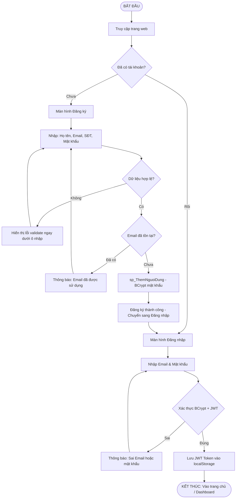
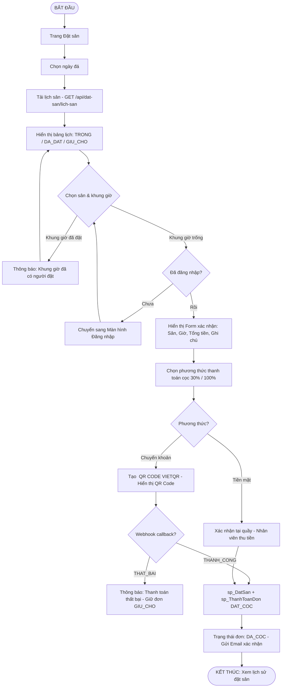
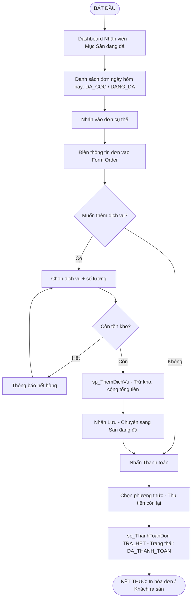

# ⚽ HỒ SƠ PHÂN TÍCH & THIẾT KẾ PHẦN MỀM
## Hệ Thống Quản Lý Và Đặt Sân Bóng Đá — Soccer247
> Tài liệu tuân thủ quy trình 6 bước Kỹ nghệ phần mềm chuẩn mực  
> Phiên bản: 1.0 · Ngày tạo: 12/10/2026

---

## BƯỚC 1 · ĐỊNH HÌNH Ý TƯỞNG & ĐÁNH GIÁ TÍNH KHẢ THI

### 1.1 Mô tả ý tưởng
Hệ thống **Soccer247** là nền tảng web quản lý và đặt sân bóng đá trực tuyến, giúp khách hàng tra cứu lịch sân, đặt cọc và thanh toán từ xa; đồng thời hỗ trợ nhân viên và quản trị viên điều hành toàn bộ hoạt động sân bóng (đặt chỗ, dịch vụ kèm theo, kho hàng, báo cáo doanh thu) trên một giao diện duy nhất.

### 1.2 Mục tiêu chung
Số hoá quy trình vận hành sân bóng đá từ khâu đặt sân → thanh toán → vào sân → báo cáo, loại bỏ hoàn toàn việc quản lý thủ công bằng sổ sách, giảm sai sót và tăng trải nghiệm người dùng.

### 1.3 Mục tiêu chi tiết
| # | Mục tiêu |
|---|-----------|
| 1 | Khách hàng đặt sân trực tuyến 24/7, xem lịch sân theo ngày thời gian thực |
| 2 | Hỗ trợ thanh toán đặt cọc 30% hoặc trả đầy đủ qua Tiền mặt / Chuyển khoản (Qua Ngân Hàng) |
| 3 | Nhân viên quản lý danh sách đang đá, bán dịch vụ tại quầy (nước, phụ kiện) |
| 4 | Quản trị viên theo dõi báo cáo doanh thu theo khoảng thời gian tùy chọn |
| 5 | Quản lý nội dung website: Banner slider, Tin tức, Liên hệ, Giới thiệu trung tâm |
| 6 | Tự động gửi thông báo đặt sân thành công qua Email (Nodemailer) |
| 7 | Khách hàng yêu cầu, phản ánh qua gmail thông qua trang Liên Hệ |

### 1.4 Kết quả mong đợi
- Website chạy mượt trên trình duyệt desktop, tablet & mobile
- Toàn bộ nghiệp vụ dữ liệu thực thi qua **Stored Procedure** — không dùng raw query
- Lịch sân cập nhật **real-time** qua Socket.IO khi có đơn đặt mới
- Tỷ lệ trích xuất đúng trạng thái sân (trống / đã đặt) đạt **100%** độ chính xác

### 1.5 Đánh giá tính khả thi

| Góc nhìn | Đánh giá |
|-----------|----------|
| **Kỹ thuật** | Backend: Node.js + Express + TypeScript + SQL Server 2022 (đã có ecosystem ổn định, Stored Procedure kiểm soát toàn bộ nghiệp vụ). Frontend: Next.js 16 + React 19 + TailwindCSS 4 + Leaflet (bản đồ). Tích hợp Cloudinary (media), Socket.IO (real-time), VietQR và PayOS. Công nghệ đủ tài liệu, không có rủi ro spike. |
| **Thời gian** | Dự án có thể triển khai trong **4–6 tuần**: 1 tuần thiết kế DB & Stored Procedure, 2 tuần Backend API, 2 tuần Frontend, 1 tuần kiểm thử & nghiệm thu. |
| **Nguồn lực** | 1–2 lập trình viên; SQL Server Express (miễn phí); Cloudinary gói Free (25GB); PayOS sandbox không tốn phí môi trường thử nghiệm. |

---

## BƯỚC 2 · XÁC ĐỊNH ACTOR VÀ HÀNH VI

### 2.1 Bảng Actor & Behavior

| STT | Actor | Loại | Hành vi chính |
|-----|-------|------|----------------|
| 1 | **Khách hàng (User)** | Primary | Đăng ký, đăng nhập, xem danh sách sân, xem lịch sân theo ngày, đặt sân trực tuyến, đặt cọc / thanh toán toàn phần, hủy đơn, xem lịch sử đặt sân, cập nhật hồ sơ cá nhân, đọc tin tức, gửi liên hệ |
| 2 | **Nhân viên (Staff)** | Primary | Đặt sân trực tiếp tại quầy, quản lý danh sách sân đang đá, bán dịch vụ (nước / phụ kiện) kèm đơn, xác nhận khách vào sân |
| 3 | **Quản trị viên (Admin)** | Primary | Toàn quyền trên hệ thống: quản lý tài khoản người dùng, quản lý sân bóng & loại sân, quản lý dịch vụ, quản lý tin tức & banner & liên hệ, xem báo cáo doanh thu chi tiết, cấu hình thông tin trung tâm (About Us) |
| 4 | **Cổng thanh toán (PayOS / VietQR )** | Secondary System | Tạo QR Code thanh toán, xác nhận giao dịch, webhook callback trả kết quả về hệ thống |
| 5 | **Dịch vụ Email (Nodemailer / SMTP)** | Secondary System | Nhận yêu cầu từ Backend, gửi email xác nhận đặt sân đến Khách hàng |
| 6 | **Dịch vụ Lưu trữ Media (Cloudinary)** | Secondary System | Nhận ảnh/video upload (sân bóng, banner, tin tức, avatar), trả về URL công khai; xóa file cũ khi cập nhật hoặc xóa record |

---

## BƯỚC 3 · USER STORIES & ACCEPTANCE CRITERIA

### Module AUTH — Xác thực & Tài khoản

---

#### US-01: Đăng ký tài khoản
> **As a** Khách hàng mới,  
> **I want to** tạo tài khoản bằng email và mật khẩu,  
> **So that** tôi có thể đặt sân và theo dõi lịch sử giao dịch.

**AC-01 · Happy Path — Đăng ký hợp lệ**
- **Given** người dùng ở màn hình Đăng ký
- **When** nhập đầy đủ Họ tên, Email hợp lệ, Số điện thoại, Mật khẩu >= 8 ký tự rồi nhấn "Đăng ký"
- **Then** hệ thống gọi `sp_ThemNguoiDung`, lưu tài khoản với vai trò Khách hàng (MaVaiTro = 3), mã hóa mật khẩu BCrypt, trả về HTTP 201 và chuyển sang màn hình Đăng nhập

**AC-02 · Error Case — Email đã tồn tại**
- **Given** người dùng ở màn hình Đăng ký
- **When** nhập email đã được đăng ký trong hệ thống
- **Then** hệ thống trả về HTTP 400 với thông báo "Email đã được sử dụng, vui lòng chọn email khác"

---

#### US-02: Đăng nhập hệ thống
> **As a** Người dùng đã có tài khoản,  
> **I want to** đăng nhập bằng email và mật khẩu,  
> **So that** tôi được cấp quyền truy cập tương ứng với vai trò của mình.

**AC-01 · Happy Path — Đăng nhập thành công**
- **Given** người dùng ở màn hình Đăng nhập
- **When** nhập email và mật khẩu đúng rồi nhấn "Đăng nhập"
- **Then** hệ thống gọi `sp_DangNhap`, xác thực BCrypt, ký JWT (7 ngày), trả về HTTP 200 kèm `{ accessToken, user: { id, ho_ten, email, vai_tro } }` và điều hướng về trang chủ

**AC-02 · Error Case — Sai mật khẩu**
- **Given** người dùng ở màn hình Đăng nhập
- **When** nhập đúng email nhưng sai mật khẩu
- **Then** hệ thống trả về HTTP 401 với thông báo "Email hoặc mật khẩu không chính xác", không tiết lộ field nào sai

---

#### US-03: Cập nhật hồ sơ cá nhân
> **As a** Khách hàng đã đăng nhập,  
> **I want to** chỉnh sửa thông tin cá nhân và ảnh đại diện,  
> **So that** thông tin liên lạc của tôi luôn được cập nhật chính xác.

**AC-01 · Happy Path — Cập nhật thành công**
- **Given** người dùng ở trang Hồ sơ, đã đăng nhập
- **When** thay đổi Họ tên / Số điện thoại / upload ảnh mới rồi nhấn "Lưu"
- **Then** hệ thống upload ảnh lên Cloudinary (xóa ảnh cũ nếu có), cập nhật DB, trả về HTTP 200 và hiển thị thông tin mới trên giao diện

**AC-02 · Error Case — Đổi mật khẩu sai mật khẩu cũ**
- **Given** người dùng muốn đổi mật khẩu
- **When** nhập mật khẩu cũ không khớp
- **Then** hệ thống trả về HTTP 400 "Mật khẩu cũ không chính xác", không thực hiện thay đổi

---

### Module DAT_SAN — Đặt sân & Lịch sân

---

#### US-04: Xem lịch sân theo ngày
> **As a** Khách hàng,  
> **I want to** xem lịch trống / bận của từng sân theo ngày,  
> **So that** tôi chọn được khung giờ phù hợp trước khi đặt.

**AC-01 · Happy Path — Hiển thị lịch đúng**
- **Given** người dùng ở trang Đặt sân, chọn ngày bất kỳ
- **When** hệ thống gọi `GET /api/dat-san/lich-san?ngay_da=YYYY-MM-DD`
- **Then** trả về danh sách các khung giờ theo từng sân: trạng thái `SAN_SANG`, `DA_COC`, `DANG_DA` hiển thị màu sắc phân biệt rõ ràng; cập nhật real-time qua Socket.IO khi có đơn mới

**AC-02 · Error Case — Ngày trong quá khứ**
- **Given** người dùng chọn ngày đã qua
- **When** tải lịch sân
- **Then** hệ thống hiển thị thông báo "Không thể đặt sân cho ngày đã qua", ẩn nút Đặt sân

---

#### US-05: Đặt sân trực tuyến
> **As a** Khách hàng đã đăng nhập,  
> **I want to** chọn sân, chọn khung giờ và đặt cọc trực tuyến,  
> **So that** tôi giữ chỗ sân mà không cần đến trực tiếp.

**AC-01 · Happy Path — Đặt sân & cọc thành công**
- **Given** người dùng đã chọn sân trống và khung giờ hợp lệ
- **When** xác nhận đặt sân và chọn phương thức thanh toán cọc 30%
- **Then** hệ thống gọi `sp_DatSan` tạo đơn trạng thái `DA_COC`, tạo lịch sử `Thanh_Toan` loại `DAT_COC`, gửi email xác nhận, trả về HTTP 200 với mã đơn

**AC-02 · Error Case — Sân đã bị đặt bởi người khác**
- **Given** người dùng đang xem khung giờ còn trống
- **When** người khác đặt trước trong cùng thời điểm và người dùng xác nhận đặt
- **Then** hệ thống rollback, trả về HTTP 409 "Khung giờ này vừa được đặt, vui lòng chọn giờ khác"

---

#### US-06: Hủy đơn & hoàn cọc
> **As a** Khách hàng đã đặt sân,  
> **I want to** hủy đơn trước giờ đá,  
> **So that** tôi được hoàn lại một phần tiền cọc theo chính sách.

**AC-01 · Happy Path — Hủy trước 24h, hoàn 100% cọc**
- **Given** đơn đang ở trạng thái `DA_COC`, còn hơn 24 giờ đến giờ đá
- **When** người dùng nhấn "Hủy đơn" và xác nhận
- **Then** hệ thống gọi `sp_HuyDonVaHoanCoc`, cập nhật trạng thái đơn thành `DA_HUY`, ghi nhận vào `Lich_Su_Hoan_Tien` với `ty_le_hoan = 100`

**AC-02 · Error Case — Hủy trong vòng 2h trước giờ đá**
- **Given** đơn còn dưới 2 giờ đến giờ đá
- **When** người dùng hủy đơn
- **Then** hệ thống thông báo "Hủy muộn — không được hoàn cọc theo chính sách", ghi `ty_le_hoan = 0`

---

### Module DICH_VU — Dịch vụ & Kho hàng

---

#### US-07: Bán dịch vụ kèm đơn đặt sân
> **As a** Nhân viên,  
> **I want to** thêm dịch vụ (nước uống, phụ kiện, trọng tài) vào đơn của khách,  
> **So that** doanh thu dịch vụ được ghi nhận chính xác vào từng đơn.

**AC-01 · Happy Path — Thêm dịch vụ thành công**
- **Given** nhân viên đang xem chi tiết đơn của khách, dịch vụ còn tồn kho
- **When** chọn dịch vụ, nhập số lượng và nhấn "Thêm vào đơn"
- **Then** hệ thống gọi `sp_ThemDichVu`, trừ tồn kho `Dich_Vu`, ghi nhận vào `Chi_Tiet_Dich_Vu`, cập nhật `tong_tien` đơn, trả về HTTP 200

**AC-02 · Error Case — Dịch vụ hết tồn kho**
- **Given** tồn kho dịch vụ = 0
- **When** nhân viên cố thêm dịch vụ đó
- **Then** hệ thống trả về HTTP 400 "Dịch vụ đã hết hàng trong kho, vui lòng nhập kho trước"

---

#### US-08: Nhập kho dịch vụ
> **As a** Nhân viên / Admin,  
> **I want to** nhập số lượng hàng mới vào kho,  
> **So that** tồn kho được cập nhật kịp thời, tránh tình trạng hết hàng.

**AC-01 · Happy Path — Nhập kho thành công**
- **Given** nhân viên ở màn hình Quản lý kho
- **When** chọn dịch vụ, nhập số lượng và giá nhập rồi xác nhận
- **Then** hệ thống gọi `sp_NhapKhoDichVu`, tăng `ton_kho` trong bảng `Dich_Vu`, tạo phiếu nhập trong `Phieu_Nhap_Kho`, trả về HTTP 200

**AC-02 · Error Case — Số lượng nhập âm hoặc bằng 0**
- **Given** nhân viên ở màn hình Nhập kho
- **When** nhập số lượng <= 0
- **Then** hệ thống hiển thị lỗi "Số lượng nhập phải lớn hơn 0", không lưu phiếu nhập

---

### Module THANH_TOAN — Thanh toán

---

#### US-09: Thanh toán toàn phần khi ra sân
> **As a** Nhân viên,  
> **I want to** thu tiền còn lại của khách trước khi ra về,  
> **So that** đơn được chốt hoàn thành và doanh thu được ghi nhận đầy đủ.

**AC-01 · Happy Path — Thanh toán trả hết thành công**
- **Given** đơn ở trạng thái `DA_COC` hoặc `DANG_DA`, còn số tiền chưa thanh toán
- **When** nhân viên chọn phương thức (Tiền mặt / Chuyển khoản) và xác nhận thu tiền
- **Then** hệ thống gọi `sp_ThanhToanDon` loại `TRA_HET`, cập nhật trạng thái đơn thành `DA_THANH_TOAN`, ghi nhận vào `Thanh_Toan`, trả về HTTP 200

**AC-02 · Error Case — Đơn đã thanh toán đủ**
- **Given** đơn đã ở trạng thái `DA_THANH_TOAN`
- **When** nhân viên cố thanh toán lại
- **Then** hệ thống trả về HTTP 400 "Đơn này đã được thanh toán đầy đủ"

---

### Module BAO_CAO — Báo cáo & Thống kê

---

#### US-10: Xem báo cáo doanh thu
> **As a** Admin / Nhân viên,  
> **I want to** xem báo cáo doanh thu chi tiết theo khoảng thời gian,  
> **So that** tôi nắm được hiệu quả kinh doanh và đưa ra quyết định phù hợp.

**AC-01 · Happy Path — Lấy báo cáo thành công**
- **Given** Admin đã đăng nhập, chọn khoảng `tu_ngay` và `den_ngay`
- **When** nhấn "Xuất báo cáo"
- **Then** hệ thống gọi `sp_BaoCaoDoanhThu`, trả về danh sách đơn với tổng tiền sân, tổng tiền dịch vụ, tổng doanh thu, hiển thị biểu đồ trực quan

**AC-02 · Error Case — Người dùng thường truy cập**
- **Given** Khách hàng đã đăng nhập
- **When** cố truy cập endpoint `/api/bao-cao/doanh-thu`
- **Then** Middleware phân quyền trả về HTTP 403 "Bạn không có quyền truy cập tính năng này"

---

### Module CONTENT — Quản lý nội dung

---

#### US-11: Quản lý Banner & Tin tức
> **As a** Admin,  
> **I want to** thêm / sửa / xóa Banner slider và bài viết Tin tức,  
> **So that** trang chủ luôn hiển thị nội dung mới nhất và hấp dẫn.

**AC-01 · Happy Path — Thêm banner video thành công**
- **Given** Admin ở trang quản lý Banner
- **When** upload file video, nhập tiêu đề và nhấn "Lưu"
- **Then** hệ thống upload video lên Cloudinary, lưu `video_url` và `loai_banner = 'VIDEO'` vào bảng `Banner`, hiển thị ngay trên slider trang chủ

**AC-02 · Error Case — Xóa banner đang được hiển thị**
- **Given** Admin xóa một banner đang active
- **When** xác nhận xóa
- **Then** hệ thống xóa file trên Cloudinary đồng thời, xóa record trong DB, cập nhật thứ tự banner còn lại

---

## BƯỚC 4 · USER FLOW

### Flow 1: Đăng ký & Đăng nhập tài khoản



---

### Flow 2: Đặt sân trực tuyến & Thanh toán cọc



---

### Flow 3: Nhân viên quản lý sân đang đá & Thanh toán cuối ca



---

## BƯỚC 5 · THIẾT KẾ MODULE & ĐẶC TẢ KỸ THUẬT

### Module 1: Auth — Xác thực & Tài khoản

| Chức năng | Input | Processing | Output |
|-----------|-------|-----------|--------|
| **1.1 Đăng ký** | `ho_ten`, `email`, `so_dien_thoai`, `mat_khau` | Validate email format; gọi `sp_ThemNguoiDung`; hash BCrypt (salt=10); lưu `MaVaiTro=3` | HTTP 201 `{ success: true }` hoặc HTTP 400 `{ success: false, message }` |
| **1.2 Đăng nhập** | `email`, `mat_khau` | Gọi `sp_DangNhap`; so khớp BCrypt; ký JWT (expires 7d) | HTTP 200 `{ accessToken, user }` hoặc HTTP 401 |
| **1.3 Lấy profile** | Bearer Token (Header) | Middleware xác thực JWT; decode `userId`; gọi `sp_LayThongTinNguoiDung` | HTTP 200 `{ user }` hoặc HTTP 401 |
| **1.4 Cập nhật profile** | `ho_ten`, `so_dien_thoai`, file ảnh (optional) | Upload ảnh lên Cloudinary (xóa ảnh cũ); cập nhật DB | HTTP 200 `{ success: true, user }` |

---

### Module 2: Dat_San — Quản lý đặt sân

| Chức năng | Input | Processing | Output |
|-----------|-------|-----------|--------|
| **2.1 Danh sách sân** | — | Gọi `sp_LayDanhSachSan`; lọc `trang_thai = SAN_SANG` | HTTP 200 `{ data: [san_bong] }` |
| **2.2 Lịch sân theo ngày** | `ngay_da` (query param) | Gọi `sp_LayLichSan`; join `Don_Dat_San` + `San_Bong`; phát Socket.IO event `lich_san_updated` | HTTP 200 `{ lich: [...] }` |
| **2.3 Đặt sân** | `ma_san`, `ngay_da`, `gio_bat_dau`, `gio_ket_thuc`, `phuong_thuc`, `ghi_chu` | Kiểm tra xung đột khung giờ trong SP (TRY-CATCH); gọi `sp_DatSan`; tạo đơn `DA_COC`; gửi email | HTTP 200 `{ ma_don }` hoặc HTTP 409 |
| **2.4 Hủy đơn** | `ma_don`, `ly_do_huy` | Tính khoảng thời gian hủy; gọi `sp_HuyDonVaHoanCoc`; tính `ty_le_hoan`; ghi `Lich_Su_Hoan_Tien` | HTTP 200 `{ so_tien_hoan }` |

---

### Module 3: Dich_Vu — Dịch vụ & Kho hàng

| Chức năng | Input | Processing | Output |
|-----------|-------|-----------|--------|
| **3.1 Danh sách dịch vụ** | — | Gọi `sp_LayDanhSachDichVu`; trả về `ton_kho` thực tế | HTTP 200 `{ data: [dich_vu] }` |
| **3.2 Thêm dịch vụ vào đơn** | `ma_don_dat`, `ma_dich_vu`, `so_luong` | Kiểm tra `ton_kho >= so_luong`; gọi `sp_ThemDichVu`; cập nhật `Chi_Tiet_Dich_Vu`; trừ `ton_kho` | HTTP 200 hoặc HTTP 400 hết hàng |
| **3.3 Nhập kho** | `ma_dich_vu`, `so_luong_nhap`, `gia_nhap` | Gọi `sp_NhapKhoDichVu`; `UPDATE ton_kho += so_luong_nhap`; tạo `Phieu_Nhap_Kho` | HTTP 200 `{ ton_kho_moi }` |

---

### Module 4: Thanh_Toan — Thanh toán

| Chức năng | Input | Processing | Output |
|-----------|-------|-----------|--------|
| **4.1 Thanh toán** | `ma_don_dat`, `loai_thanh_toan` (DAT_COC / TRA_HET), `phuong_thuc` (TIEN_MAT / CHUYEN_KHOAN) | Gọi `sp_ThanhToanDon`; tính `so_tien` theo loại; ghi `Thanh_Toan`; cập nhật trạng thái đơn | HTTP 200 `{ success, trang_thai_don }` |
| **4.2 Tạo link PayOS** | `ma_don_dat`, `so_tien` | Gọi PayOS SDK tạo payment link; lưu `ma_giao_dich`; set trạng thái `CHO_XU_LY` | HTTP 200 `{ checkoutUrl, qrCode }` |
| **4.3 Webhook callback** | Payload từ PayOS | Xác thực signature; cập nhật trạng thái giao dịch `THANH_CONG` / `THAT_BAI`; phát Socket event | HTTP 200 |

---

### Module 5: Bao_Cao — Báo cáo & Thống kê

| Chức năng | Input | Processing | Output |
|-----------|-------|-----------|--------|
| **5.1 Báo cáo doanh thu** | `tu_ngay`, `den_ngay` (query param) | Middleware kiểm tra quyền ADMIN / NHAN_VIEN; gọi `sp_BaoCaoDoanhThu`; tổng hợp tiền sân + tiền dịch vụ | HTTP 200 `{ tong_tien_san, tong_tien_dich_vu, tong_doanh_thu, chi_tiet: [...] }` |

---

### Module 6: Content — Quản lý nội dung

| Chức năng | Input | Processing | Output |
|-----------|-------|-----------|--------|
| **6.1 Quản lý Banner** | `tieu_de`, `loai_banner` (IMAGE/VIDEO), file media, `lien_ket`, `thu_tu` | Upload lên Cloudinary; lưu `hinh_anh` / `video_url`; CRUD bảng `Banner` | HTTP 200 `{ banner }` |
| **6.2 Quản lý Tin tức** | `ma_loai_tin`, `tieu_de`, `noi_dung`, file ảnh | Upload ảnh Cloudinary; CRUD bảng `Tin_Tuc` | HTTP 200 `{ tin_tuc }` |
| **6.3 Quản lý Liên hệ** | — | Lấy danh sách `Lien_He` chưa xử lý; Admin trả lời và cập nhật `trang_thai_xu_ly = DA_XU_LY` | HTTP 200 `{ lien_he }` |
| **6.4 Cấu hình About Us** | `ten_trung_tam`, `hotline`, `dia_chi`, `link_map`, v.v. | CRUD bảng `About_Us` | HTTP 200 `{ about_us }` |

---

## BƯỚC 6 · VIBE CODING — HƯỚNG DẪN TRIỂN KHAI VỚI AI

### 6.1 Chuẩn bị tài liệu SRS

Tổng hợp toàn bộ Bước 1–5 thành **file `SRS.md`** duy nhất (tức file này), rà soát lại:
- Không còn User Story nào thiếu AC
- Mọi SP trong `ThuTuc.sql` đều có chức năng tương ứng trong Module
- Không có xung đột logic giữa các trạng thái đơn hàng

### 6.2 System Prompt mẫu

```
Bạn là Full-stack Senior Software Architect chuyên nghiệp.
Nhiệm vụ: lập trình Hệ thống Quản lý Sân Bóng theo đúng SRS đính kèm.

Tech Stack cố định — KHÔNG được tự ý thay đổi:
- Backend: Node.js + Express + TypeScript
- Database: SQL Server 2022 — 100% thao tác qua Stored Procedure
  Tuyệt đối KHÔNG dùng raw .query()
- ORM/Driver: mssql (ConnectionPool)
- Auth: JWT (jsonwebtoken) + BCrypt (bcryptjs)
- Upload: Multer + Cloudinary SDK
- Real-time: Socket.IO
- Frontend: Next.js 16 + React 19 + TailwindCSS 4
- UI Icons: Lucide React
- Bản đồ: Leaflet

Nguyên tắc bắt buộc:
1. Mọi response API: { success: boolean, message: string, data?: any }
2. SQL dùng TRY...CATCH và THROW trong Stored Procedure
3. Middleware authMiddleware kiểm tra JWT trước mọi route bảo vệ
4. Khi upload/xóa ảnh: luôn xóa file cũ trên Cloudinary trước khi lưu mới
```

### 6.3 Thứ tự sinh code theo module

| Lệnh | Nội dung prompt cho AI |
|------|------------------------|
| **Lệnh 1** | "Dựa vào Bước 5 trong SRS, thiết kế lại file `QuanLySanBong.sql` hoàn chỉnh với đầy đủ bảng, khóa chính, khóa ngoại, index hiệu năng và dữ liệu mẫu (INSERT)" |
| **Lệnh 2** | "Viết toàn bộ Stored Procedure cho Module Auth (`sp_ThemNguoiDung`, `sp_DangNhap`, `sp_LayThongTinNguoiDung`) theo đúng I-P-O trong SRS" |
| **Lệnh 3** | "Implement `authController.ts` và `authRoutes.ts` cho Module 1 Auth theo AC của US-01 và US-02 trong SRS" |
| **Lệnh 4** | "Implement Module Đặt sân: `datSanController.ts` xử lý đúng AC của US-04, US-05, US-06; tích hợp Socket.IO emit sau mỗi đặt/hủy" |
| **Lệnh 5** | "Implement Module Thanh toán: tích hợp PayOS SDK, xử lý webhook callback, cập nhật trạng thái đơn đúng flow US-09" |
| **Lệnh 6** | "Tạo trang `index.tsx` (trang chủ): Banner Slider, Danh sách sân, Bảng lịch sân real-time (Socket.IO client) đúng thiết kế" |
| **Lệnh 7** | "Tạo trang `management-system.tsx` (Dashboard nhân viên): Sân đang đá, Form order, Thêm dịch vụ, Thanh toán cuối ca đúng flow US-07, US-08, US-09" |

### 6.4 Checklist nghiệm thu trước khi nộp

- [ ] **Bước 1**: Có đủ 4 thành tố ý tưởng, đánh giá 3 góc nhìn khả thi
- [ ] **Bước 2**: Tối thiểu 3 Primary Actor + 3 Secondary System Actor
- [ ] **Bước 3**: 11 User Stories, 100% kèm Given-When-Then (Happy + Error)
- [ ] **Bước 4**: 3 sơ đồ luồng, đúng ký hiệu Mermaid, có rẽ nhánh và vòng lặp lỗi
- [ ] **Bước 5**: 6 Module, mỗi chức năng đặc tả đầy đủ I-P-O
- [ ] **Bước 6**: Code chạy được, trạng thái đơn đúng flow, API response đúng chuẩn

---

## PHỤ LỤC — TECH STACK & CẤU TRÚC DỰ ÁN

### Công nghệ sử dụng

| Tầng | Công nghệ |
|------|-----------|
| **Frontend** | Next.js 16, React 19, TailwindCSS 4, Lucide React, Leaflet (bản đồ), Socket.IO Client |
| **Backend** | Node.js, Express, TypeScript, tsx (hot-reload) |
| **Database** | SQL Server 2022, mssql driver, Stored Procedure 100% |
| **Auth & Security** | JWT (7 ngày), BCrypt (salt=10), Role-based Middleware |
| **Media** | Cloudinary (ảnh + video), Multer (upload handler) |
| **Real-time** | Socket.IO (lịch sân cập nhật tức thì) |
| **Thanh toán** | PayOS SDK, VNPay, Momo |
| **Email** | Nodemailer (SMTP) |

### Cấu trúc CSDL — Các bảng chính

```
Vai_Tro           → Phân quyền: Admin (1), Nhân viên (2), Khách hàng (3)
Nguoi_Dung        → Tài khoản người dùng, liên kết Vai_Tro
Loai_San          → Phân loại sân (5 người, 7 người, ...)
San_Bong          → Chi tiết từng sân, đơn giá/phút, trạng thái
Khung_Gio         → Ma trận khung giờ 6h–22h
Don_Dat_San       → Đơn đặt sân (hỗ trợ NULL ma_san cho đơn bán lẻ)
Thanh_Toan        → Lịch sử thanh toán cọc / trả hết
Lich_Su_Hoan_Tien → Ghi nhận hủy đơn và hoàn cọc
Dich_Vu           → Danh mục dịch vụ (nước, phụ kiện, trọng tài)
Chi_Tiet_Dich_Vu  → Dịch vụ kèm theo trong từng đơn
Phieu_Nhap_Kho    → Lịch sử nhập kho
Banner            → Banner slider trang chủ (IMAGE / VIDEO)
Tin_Tuc           → Bài viết tin tức
Loai_Tin_Tuc      → Danh mục tin tức
Lien_He           → Phản hồi / góp ý từ khách hàng
About_Us          → Thông tin trung tâm, hotline, địa chỉ, mạng xã hội
```

### API Endpoints tổng hợp

| Module | Method | Endpoint | Quyền |
|--------|--------|----------|-------|
| Auth | POST | `/api/auth/register` | Public |
| Auth | POST | `/api/auth/login` | Public |
| Auth | GET | `/api/auth/profile` | Bearer Token |
| Đặt sân | GET | `/api/dat-san/danh-sach-san` | Public |
| Đặt sân | GET | `/api/dat-san/lich-san?ngay_da=` | Public |
| Đặt sân | POST | `/api/dat-san` | Bearer Token |
| Đặt sân | POST | `/api/dat-san/huy-don` | Bearer Token |
| Dịch vụ | GET | `/api/dich-vu` | Public |
| Dịch vụ | POST | `/api/dich-vu/them-vao-don` | Bearer Token |
| Dịch vụ | POST | `/api/dich-vu/nhap-kho` | ADMIN, NHAN_VIEN |
| Thanh toán | POST | `/api/thanh-toan` | Bearer Token |
| Báo cáo | GET | `/api/bao-cao/doanh-thu?tu_ngay=&den_ngay=` | ADMIN, NHAN_VIEN |
| Nội dung | GET/POST/PUT/DELETE | `/api/content/banner` | ADMIN |
| Nội dung | GET/POST/PUT/DELETE | `/api/content/tin-tuc` | ADMIN |
| Nội dung | GET/PATCH | `/api/content/lien-he` | ADMIN, NHAN_VIEN |
| Nội dung | GET/PUT | `/api/content/about-us` | ADMIN |
