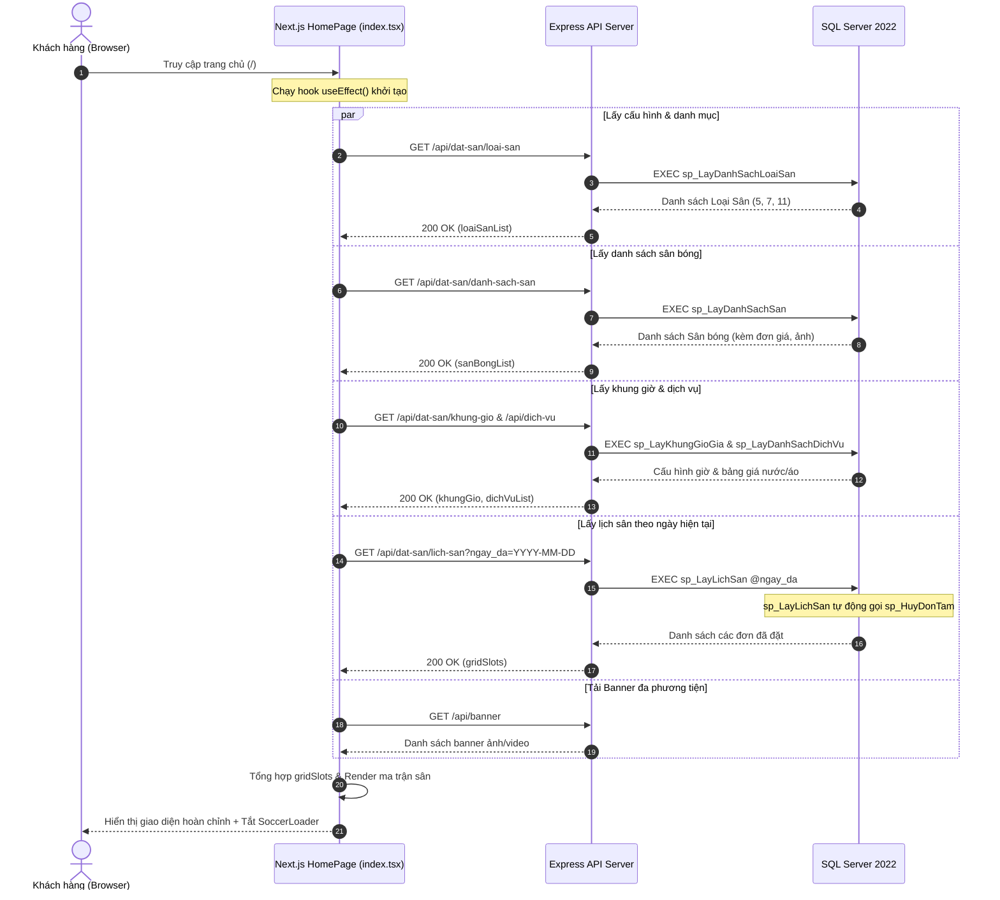
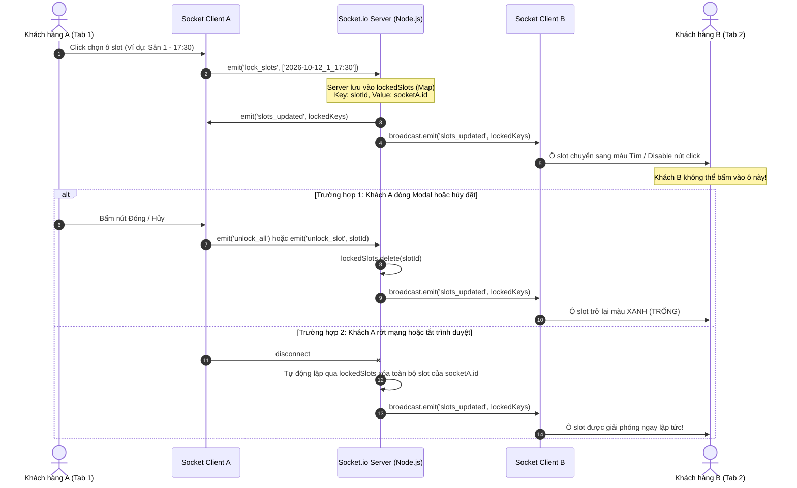
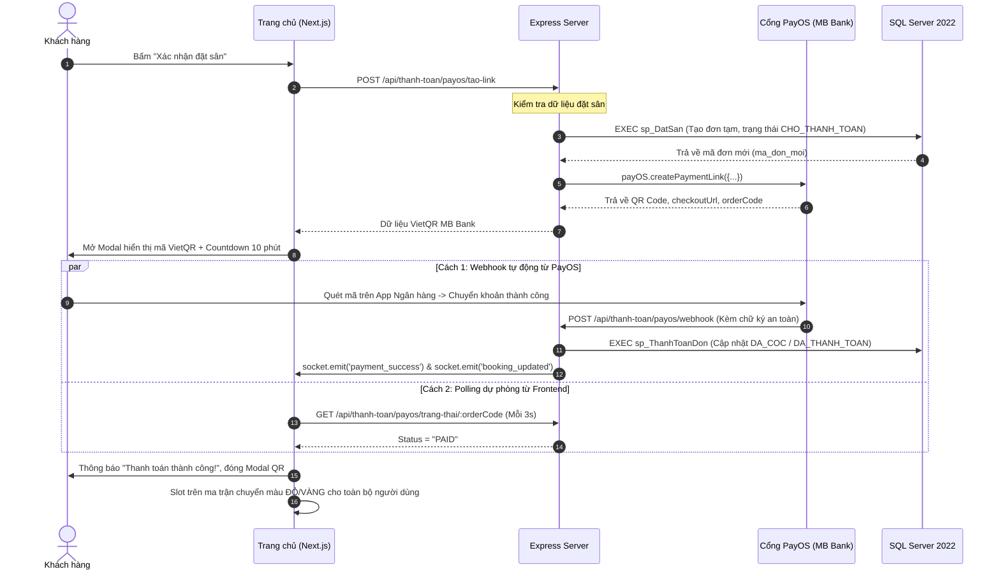

# BỘ CÂU HỎI VÀ ĐÁP ÁN BẢO VỆ ĐỒ ÁN TỐT NGHIỆP: CHUYÊN ĐỀ TRANG CHỦ (HOMEPAGE)
**Hệ thống:** Quản lý và Đặt sân bóng đá trực tuyến (`QuanLySanBong`)  
**Sinh viên thực hiện:** Cao Văn Hột Xoàn — **MSSV:** 525000462  
**Mục tiêu tài liệu:** Cung cấp đầy đủ toàn bộ câu hỏi vấn đáp mà Giáo viên hướng dẫn / Giáo viên phản biện / Hội đồng chấm tốt nghiệp sẽ hỏi xoay quanh **Giao diện Trang chủ (Homepage)**, bao gồm công nghệ, thư viện, ngôn ngữ, cơ chế hoạt động, luồng dữ liệu, mã nguồn thực tế và chiến thuật trả lời ghi điểm tối đa.

---

## MỤC LỤC TỔNG QUAN
1. [Tổng quan về Trang Chủ trong Hệ thống](#1-tổng-quan-về-trang-chủ-trong-hệ-thống)
2. [Hệ sinh thái Công nghệ, Thư viện & Ngôn ngữ sử dụng](#2-hệ-sinh-thái-công-nghệ-thư-viện--ngôn-ngữ-sử-dụng)
3. [Kiến trúc & Cơ chế hoạt động của Trang Chủ](#3-kiến-trúc--cơ-chế-hoạt-động-của-trang-chủ)
4. [Các Stored Procedures trong SQL Server phục vụ Trang Chủ](#4-các-stored-procedures-trong-sql-server-phục-vụ-trang-chủ)
5. [Bộ câu hỏi vấn đáp chi tiết theo từng chuyên đề](#5-bộ-câu-hỏi-vấn-đáp-chi-tiết-theo-từng-chuyên-đề)
   - [Chuyên đề 1: Kiến trúc, Công nghệ & Ngôn ngữ (Tech Stack)](#chuyên-đề-1-kiến-trúc-công-nghệ--ngôn-ngữ-tech-stack)
   - [Chuyên đề 2: Tính năng Giữ chỗ & Khóa Slot Thời gian thực (Socket.io)](#chuyên-đề-2-tính-năng-giữ-chỗ--khóa-slot-thời-gian-thực-socketio)
   - [Chuyên đề 3: Quy trình Đặt sân & Tích hợp Cổng thanh toán PayOS VietQR](#chuyên-đề-3-quy-trình-đặt-sân--tích-hợp-cổng-thanh-toán-payos-vietqr)
   - [Chuyên đề 4: Tầng Cơ sở dữ liệu & 100% Stored Procedures](#chuyên-đề-4-tầng-cơ-sở-dữ-liệu--100-stored-procedures)
   - [Chuyên đề 5: Frontend UI/UX, Quản lý State & Tối ưu hiệu năng](#chuyên-đề-5-frontend-uiux-quản-lý-state--tối-ưu-hiệu-năng)
   - [Chuyên đề 6: Bộ câu hỏi "Bẫy" & Tình huống biên (Edge Cases / Trap Questions)](#chuyên-đề-6-bộ-câu-hỏi-bẫy--tình-huống-biên-edge-cases--trap-questions)
6. [Bảng tra cứu nhanh File Code & Function quan trọng](#6-bảng-tra-cứu-nhanh-file-code--function-quan-trọng)
7. [Kinh nghiệm & Bí quyết trả lời tự tin trước Hội đồng](#7-kinh-nghiệm--bí-quyết-trả-lời-tự-tin-trước-hội-đồng)

---

## 1. TỔNG QUAN VỀ TRANG CHỦ TRONG HỆ THỐNG

### 1.1. Mục đích và vai trò của Trang Chủ
Trang chủ (`qlsanbong_fontend/src/pages/index.tsx`) là **bộ mặt và trung tâm tương tác chính (Core Hub)** của toàn bộ hệ thống đối với khách hàng:
- Giúp khách hàng tra cứu trạng thái sân bóng theo thời gian thực (trống, đang chờ cọc, đã chốt).
- Cho phép khách hàng lọc theo ngày, theo loại sân (sân 5, sân 7, sân 11) và tìm kiếm sân nhanh chóng.
- Cung cấp tính năng **Khóa slot giữ chỗ Real-time** bằng Socket.io chống xung đột đặt trùng giờ.
- Hỗ trợ đặt sân và tích hợp thanh toán tự động qua **VietQR PayOS (Ngân hàng Quân đội MB Bank)**.
- Cho phép đặt thêm dịch vụ đi kèm (nước ngọt, áo tập bib, trọng tài, bóng thi đấu).
- Hiển thị truyền thông đa phương tiện qua Banner Slider thông minh (tự động phát video/hình ảnh).

### 1.2. Các phân vùng giao diện chính trên Trang Chủ
1. **Thanh điều hướng (Navbar Header):**
   - Logo thương hiệu + Tên sân bóng.
   - Ô tìm kiếm nhanh tên sân bóng (`searchCourtName`).
   - Điều hướng: Trang chủ, Giới thiệu (`about-us`), Tin tức (`tin-tuc`), Liên hệ (`lien-he`), Lịch sử đặt sân (`history`).
   - Nút lối tắt chuyển đến **Hệ thống Quản lý (Management System / Dashboard)** khi đăng nhập tài khoản có quyền `ADMIN` hoặc `QUAN_TRI_VIEN`.
   - Nút bật/tắt Dark/Light Theme (`useAppTheme`).
   - Menu tài khoản: Đăng nhập / Đăng ký Modal (`Login`), Xem thông tin cá nhân (`Profile`), Đăng xuất.
2. **Hero Banner Slider Đa phương tiện:**
   - Hỗ trợ trình chiếu cả **Ảnh** và **Video** nạp từ Database/Cloudinary.
   - Ảnh: Chuyển slide sau 9 giây; Video: Chuyển slide ngay khi video phát hết thời lượng.
   - Hỗ trợ thanh tiến trình (Progress bar), bật/tắt âm thanh (Mute/Unmute), các nút chuyển slide trước/sau.
3. **Thanh chọn ngày trực quan (`DateNavigationBar`):**
   - Cho phép chọn nhanh ngày trong tuần, tự động highlight ngày hôm nay.
   - Đồng bộ tải lại ma trận lịch sân theo ngày tương ứng.
4. **Khu vực Bộ lọc & Thống kê nhanh (Filter & Metrics):**
   - Lọc theo danh mục Loại sân: Tất cả, Sân 5 người, Sân 7 người, Sân 11 người.
   - Chú thích màu sắc trạng thái các ô slot:
     - 🟩 **Màu xanh lục (TRỐNG):** Sân sẵn sàng, khách có thể click đặt ngay.
     - 🟨 **Màu vàng (CHỜ XÁC NHẬN):** Đang có khách giữ chỗ hoặc đơn cọc chờ xử lý.
     - 🟥 **Màu đỏ (ĐÃ CHỐT):** Đơn đã thanh toán đầy đủ / Đã chốt trên hệ thống.
     - 🟪 **Màu tím / Viền nhấp nháy (ĐANG CHỌN):** Slot do chính khách hàng hoặc khách hàng khác đang thao tác giữ chỗ Real-time.
5. **Ma trận Lưới Sân & Khung giờ (Interactive Court Matrix Grid):**
   - Trục dọc: Danh sách các sân bóng thuộc cụm sân (kèm đơn giá trên phút, loại sân).
   - Trục ngang: Các mốc khung giờ bóng đá (sáng, chiều, tối).
   - Ô giao điểm: Tương ứng một slot giờ đá của sân cụ thể trong ngày được chọn.
6. **Modal Đặt sân & Dịch vụ (Booking Modal):**
   - Hiển thị chi tiết sân, khung giờ bắt đầu và kết thúc, đơn giá tính theo phút/giờ.
   - Danh sách dịch vụ đi kèm (nước uống, áo, trọng tài) có bộ đếm tăng/giảm số lượng.
   - Tính tổng tiền tự động = Tiền sân + Tiền dịch vụ.
   - Nhập thông tin khách hàng (Họ tên, Số điện thoại, Ghi chú).
   - Lựa chọn hình thức thanh toán: Cọc 30%, Thanh toán 100%, hoặc Trả sau tại sân.
7. **Modal Thanh toán VietQR PayOS:**
   - Hiển thị mã QR PayOS tự động sinh tương ứng số tiền chính xác và mã đơn hàng.
   - Đồng hồ đếm ngược giữ chỗ tạm thời (Countdown Timer).
   - Socket lắng nghe phản hồi giao dịch thành công để tự động đóng Modal và cập nhật trạng thái sân.
8. **Chân trang (Footer Component):**
   - Thông tin liên hệ, hotline, địa chỉ, bản đồ, bản quyền hệ thống.

---

## 2. HỆ SINH THÁI CÔNG NGHỆ, THƯ VIỆN & NGÔN NGỮ SỬ DỤNG

### 2.1. Ngôn ngữ lập trình
- **TypeScript (v5.x Frontend, v7.x/tsx Backend):** Sử dụng 100% trên cả Frontend và Backend. Cung cấp hệ thống Static Typing mạnh mẽ, định nghĩa rõ ràng các `Interface` dữ liệu (`SanBong`, `LoaiSan`, `SlotLichSan`, `PayOSData`), loại trừ lỗi ép kiểu `undefined/null` lúc runtime.
- **SQL (Transact-SQL / T-SQL):** Ngôn ngữ thủ tục nâng cao trên Microsoft SQL Server, dùng để viết toàn bộ các **Stored Procedures**, quản lý Transaction, Try...Catch và kiểm soát tính toàn vẹn dữ liệu.
- **HTML5 & CSS3:** Cấu trúc ngữ nghĩa và giao diện linh hoạt.

### 2.2. Frontend Framework & Thư viện
- **Next.js 16 (Pages Router):** Framework React mạnh mẽ, tối ưu hóa quá trình biên dịch, nén code, quản lý route tự động (`/`, `/about-us`, `/tin-tuc`, `/history`), tương thích tốt với client-side socket.
- **React 19:** Tận dụng tối đa các React Hooks hiện đại: `useState`, `useEffect`, `useMemo`, `useCallback`, `useRef`.
- **TailwindCSS v4:** Framework CSS Utility-first phiên bản mới nhất, biên dịch siêu tốc, thiết lập biến màu linh hoạt cho Dark Mode (`bg-slate-900`, `text-emerald-400`, v.v.).
- **Socket.io-client (v4.8.4):** Kết nối WebSocket hai chiều liên tục với backend để đồng bộ việc khóa slot và thông báo đơn mới theo thời gian thực.
- **Lucide-React (v1.48.0):** Bộ icon SVG chuẩn hóa, nhẹ, sắc nét và hiện đại.
- **Leaflet & @types/leaflet (v1.9.4):** Hiển thị bản đồ vị trí sân bóng tại chân trang/liên hệ.

### 2.3. Backend & Nền tảng Máy chủ
- **Node.js (v20+ LTS):** Môi trường runtime JavaScript phía máy chủ, xử lý bất đồng bộ I/O non-blocking với Event Loop.
- **Express.js (v4.19.2):** Web framework gọn nhẹ, xây dựng kiến trúc RESTful API phục vụ Frontend.
- **Socket.io (v4.8.4):** Server WebSocket quản lý danh sách client kết nối, lưu trữ `lockedSlots` trên RAM và phát sự kiện (broadcast).
- **mssql (v10.0.4):** Driver kết nối chính thức giữa Node.js và SQL Server, hỗ trợ Connection Pooling (`poolPromise`), truyền tham số Parameterized Queries an toàn và thực thi Stored Procedures (`.execute()`).
- **compression (v1.8.2):** Middleware nén dữ liệu phản hồi HTTP (Gzip/Brotli) giúp giảm 60-80% dung lượng JSON trả về cho client.
- **cors (v2.8.5):** Quản lý Cross-Origin Resource Sharing an toàn.
- **dotenv (v16.4.5):** Quản lý cấu hình biến môi trường (`PORT`, `DB_CONFIG`, `PAYOS_KEYS`, `CLOUDINARY_URL`).
- **jsonwebtoken (JWT v9.0.2) & bcryptjs (v2.4.3):** Mã hóa mật khẩu và xác thực người dùng không trạng thái (Stateless Authentication).

### 2.4. Tích hợp Bên thứ ba (Third-party Integrations)
- **Cổng thanh toán PayOS (@payos/node v2.0.5):** Tích hợp Open Banking chuẩn VietQR, tự động tạo mã QR động ngân hàng MB Bank, hỗ trợ Webhook báo có tiền tức thì không cần can thiệp thủ công.
- **Cloudinary (v2.11.0) & Multer (v2.4.0):** Dịch vụ CDN lưu trữ hình ảnh sân bóng và video banner trực tuyến chất lượng cao.

### 2.5. Hệ quản trị Cơ sở dữ liệu
- **Microsoft SQL Server 2022:** RDBMS chuẩn doanh nghiệp, lưu trữ toàn bộ dữ liệu nghiệp vụ: Người dùng, Loại sân, Sân bóng, Khung giờ, Bảng giá, Dịch vụ, Đơn đặt sân, Chi tiết dịch vụ, Giao dịch thanh toán.
- **Kiến trúc dữ liệu:** **100% Stored Procedures** — Backend Node.js không sử dụng bất kỳ câu lệnh SQL raw dạng `SELECT * FROM ...` nào trong mã nguồn điều khiển (Controller).

---

## 3. KIẾN TRÚC & CƠ CHẾ HOẠT ĐỘNG CỦA TRANG CHỦ

### 3.1. Luồng tải trang khởi đầu (Initial Page Load Flow)


---

### 3.2. Cơ chế Khóa Slot Thời gian thực (Real-time Court Locking via Socket.io)
Đây là **tính năng quan trọng nhất** của Trang chủ giúp xử lý bài toán xung đột đặt trùng giờ (Race Condition / Overbooking).



---

### 3.3. Quy trình Đặt sân & Tích hợp Thanh toán PayOS VietQR


---

## 4. CÁC STORED PROCEDURES TRONG SQL SERVER PHỤC VỤ TRANG CHỦ

Khi được giáo viên hỏi: *"Trang chủ gọi những thủ tục nào trong CSDL?"*, bạn hãy liệt kê chính xác các Stored Procedure sau:

| STT | Tên Stored Procedure | Tham số chính | Vai trò trên Trang Chủ |
| :--- | :--- | :--- | :--- |
| 1 | `sp_LayDanhSachLoaiSan` | *Không có* | Lấy danh mục các loại sân (Sân 5, Sân 7, Sân 11) để hiển thị thanh lọc loại sân |
| 2 | `sp_LayDanhSachSan` | `@trang_thai` (mặc định `'SAN_SANG'`) | Lấy danh sách sân bóng kèm đơn giá theo phút (`don_gia_phut`), hình ảnh sân |
| 3 | `sp_LayKhungGioGia` | *Không có* | Lấy cấu hình các khung giờ sáng/chiều/tối và hệ số giá giờ vàng |
| 4 | `sp_LayDanhSachDichVu`| *Không có* | Lấy danh sách các dịch vụ phụ trợ (nước ngọt, áo bib, trọng tài) kèm đơn giá |
| 5 | `sp_LayLichSan` | `@ngay_da DATE`, `@ma_san INT = NULL` | **Thủ tục cốt lõi:** Lấy toàn bộ đơn đặt trong ngày được chọn để tô màu ma trận slot. **Đặc biệt: Tự động chạy `EXEC sp_HuyDonTam` trước khi truy vấn để quét sạch đơn giữ chỗ đã hết hạn!** |
| 6 | `sp_DatSan` | `@ma_nguoi_dung`, `@ma_san`, `@ngay_da`, `@gio_bat_dau`, `@gio_ket_thuc`, `@tien_san`, `@tong_tien`, `@trang_thai` | Tạo đơn đặt sân mới, tính tiền sân, thực hiện trong `BEGIN TRANSACTION` và kiểm tra trùng lịch |
| 7 | `sp_HuyDonTam` | *Không có* | Quét và hủy các đơn giữ chỗ tạm thời quá 10-15 phút chưa thanh toán, nhả slot cho khách khác |
| 8 | `sp_ThanhToanDon` | `@ma_don_dat`, `@phuong_thuc`, `@loai_thanh_toan`, `@so_tien`, `@ma_giao_dich` | Cập nhật thanh toán sau khi PayOS báo có tiền, chuyển trạng thái đơn sang `DA_COC` hoặc `DA_THANH_TOAN` |

---

## 5. BỘ CÂU HỎI VẤN ĐÁP CHI TIẾT THEO TỪNG CHUYÊN ĐỀ

### CHUYÊN ĐỀ 1: KIẾN TRÚC, CÔNG NGHỆ & NGÔN NGỮ (TECH STACK)

#### Câu 1: Em hãy trình bày kiến trúc tổng thể của hệ thống khi chạy Trang chủ?
* **Trả lời chuẩn:**
  > "Dạ thưa Thầy/Cô, hệ thống được xây dựng theo kiến trúc **Client - Server phân tầng (Decoupled Client-Server Architecture)**:
  > - **Tầng Giao diện (Client):** Sử dụng **Next.js 16** và **React 19** với **TailwindCSS v4**, giao tiếp với Backend qua RESTful API (giao thức HTTP/HTTPS) và lắng nghe sự kiện qua WebSocket (Socket.io-client).
  > - **Tầng Máy chủ (Backend):** Sử dụng **Node.js** với framework **Express.js** và **TypeScript**. Backend đóng vai trò cung cấp API, xác thực quyền, quản lý kết nối Socket.io và làm cầu nối bảo mật với Cổng thanh toán PayOS.
  > - **Tầng Dữ liệu (Database):** Sử dụng **Microsoft SQL Server 2022**. Điểm đặc biệt của đồ án là toàn bộ logic nghiệp vụ truy xuất và kiểm tra dữ liệu ở tầng DB được đóng gói **100% trong Stored Procedures (Thủ tục lưu trữ)**, Backend không dùng raw query."

#### Câu 2: Tại sao em lại dùng Next.js kết hợp với Express.js riêng biệt mà không dùng luôn Next.js API Routes (Fullstack Next.js)?
* **Trả lời chuẩn:**
  > "Dạ thưa Thầy/Cô, em tách biệt Express.js và Next.js vì các lý do kỹ thuật sau:
  > 1. **Khả năng duy trì kết nối WebSocket bền vững:** Tính năng khóa slot thời gian thực của Trang chủ yêu cầu một máy chủ WebSocket chạy tiến trình liên tục (Long-running process) để lưu trữ danh sách slot bị khóa trên bộ nhớ RAM (`Map<slotId, socketId>`). Next.js API Routes (đặc biệt khi triển khai trên Vercel/Serverless) hoạt động theo mô hình Stateless/Ephemeral, sẽ tự hủy tiến trình sau mỗi request nên không thể duy trì kết nối WebSocket ổn định.
  > 2. **Phân tách trách nhiệm (Separation of Concerns):** Frontend chỉ lo phần render giao diện, UX và tối ưu hóa hiển thị. Backend Express độc lập quản lý bảo mật, kết nối SQL Server Connection Pool, xử lý Webhook PayOS và chạy các tiến trình nền.
  > 3. **Khả năng mở rộng (Scalability):** Khi hệ thống phát triển thêm ứng dụng Mobile App (React Native/Flutter), backend Express hiện tại có thể tái sử dụng 100% các API mà không cần sửa đổi."

#### Câu 3: Tại sao đồ án sử dụng TypeScript thay vì JavaScript thuần?
* **Trả lời chuẩn:**
  > "Dạ thưa Thầy/Cô, dự án có cấu trúc dữ liệu đặt sân khá phức tạp (nhiều thuộc tính như `ma_don_dat`, `gio_bat_dau`, `gio_ket_thuc`, trạng thái slot, thông tin thanh toán VietQR). Em chọn TypeScript vì 3 ưu điểm vượt trội:
  > 1. **Kiểm soát kiểu chặt chẽ (Static Typing):** Phát hiện lỗi sai tên thuộc tính, sai kiểu dữ liệu ngay trong quá trình viết code (Compile-time) thay vì chờ tới khi chạy ứng dụng (Runtime) mới phát hiện lỗi.
  > 2. **Tự động gợi ý code (IntelliSense):** Khi import các interface như `SanBong`, `SlotLichSan`, `PayOSData`, IDE tự động gợi ý chính xác từng thuộc tính giúp tăng tốc độ phát triển và tránh lỗi chính tả.
  > 3. **Dễ bảo trì và làm việc nhóm:** Dễ dàng refactor code, khi sửa đổi một kiểu dữ liệu thì TypeScript sẽ báo lỗi ngay ở tất cả các file bị ảnh hưởng."

#### Câu 4: Middleware `compression` trên Express có tác dụng gì cụ thể đối với Trang chủ?
* **Trả lời chuẩn:**
  > "Dạ thưa Thầy/Cô, trên file `server.ts`, em có khai báo `app.use(compression())`.
  > Trang chủ cần tải lượng dữ liệu tương đối lớn từ CSDL gồm: danh sách toàn bộ sân bóng, danh mục loại sân, bảng giá và toàn bộ lưới lịch đặt sân trong ngày. Middleware `compression` sử dụng thuật toán nén **Gzip/Brotli** để nén dữ liệu phản hồi JSON trước khi gửi qua mạng.
  > Nhờ đó, kích thước gói tin JSON truyền tải giảm từ **60% đến 80%**, giúp Trang chủ tải nhanh hơn rõ rệt, tiết kiệm băng thông máy chủ và mang lại trải nghiệm mượt mà cho người dùng mạng yếu."

---

### CHUYÊN ĐỀ 2: TÍNH NĂNG GIỮ CHỖ & KHÓA SLOT THỜI GIAN THỰC (SOCKET.IO)

#### Câu 5: Em hãy phân tích chi tiết: Tại sao Trang chủ cần tính năng Khóa Slot thời gian thực và cách em hiện thực nó bằng Socket.io?
* **Trả lời chuẩn:**
  > "Dạ thưa Thầy/Cô, trong các hệ thống đặt sân bóng truyền thống, thường xảy ra vấn đề **Xung đột đặt trùng giờ (Race Condition / Overbooking)**: Khách hàng A và Khách hàng B cùng nhìn thấy một sân trống lúc 18:00, cả hai cùng nhấn vào để điền thông tin và thanh toán. Người bấm sau sẽ bị báo lỗi hoặc nghiêm trọng hơn là cả hai cùng chuyển tiền vào một giờ đá.
  > 
  > Để giải quyết triệt để vấn đề này, em đã xây dựng **Cơ chế Khóa slot thời gian thực**:
  > 1. **Phía Server (`server.ts`):** Em duy trì một cấu trúc dữ liệu `lockedSlots = new Map<string, string>()`, lưu cặp khóa `slotId` (ví dụ: `2026-10-12_1_17:30`) và `socket.id` của người đang giữ.
  > 2. **Khi Khách hàng A click vào ô slot trên Trang chủ:** Client phát sự kiện `socket.emit('lock_slots', [slotId])`. Server lưu vào Map và dùng `io.emit('slots_updated', ...)` để broadcast danh sách các ô đang bị khóa tới **toàn bộ tất cả các máy khách đang mở Trang chủ**.
  > 3. **Phía Khách hàng B:** Khi nhận sự kiện `slots_updated`, ô slot đó ngay lập tức chuyển sang trạng thái bị khóa (hiển thị màu tím nhấp nháy hoặc xám) và nút bấm bị vô hiệu hóa (`disabled`), ngăn chặn hoàn toàn việc Khách hàng B bấm vào đặt trùng.
  > 4. **Giải phóng slot:** Khi Khách A đóng modal hoặc hoàn tất đặt sân, client phát `unlock_all` để nhả slot. Nếu Khách A mất kết nối hoặc tắt trình duyệt, sự kiện `disconnect` trên server sẽ tự động xóa các ô của `socket.id` đó và phát thông báo nhả slot ngay lập tức."

#### Câu 6: Danh sách `lockedSlots` lưu trên bộ nhớ RAM (In-Memory Map) của Node.js có ưu điểm và nhược điểm gì? Nếu trong thực tế muốn mở rộng hệ thống thì em cải tiến thế nào?
* **Trả lời chuẩn:**
  > "Dạ thưa Thầy/Cô:
  > - **Ưu điểm:** Tốc độ đọc/ghi cực kỳ nhanh (micro-giây), không gây áp lực tải (I/O) lên ổ cứng hay CSDL SQL Server khi có hàng trăm người liên tục click chọn/bỏ chọn slot.
  > - **Nhược điểm:** Dữ liệu chỉ nằm trong bộ nhớ RAM của một tiến trình Node.js duy nhất. Nếu máy chủ bị khởi động lại (restart) thì danh sách tạm này sẽ mất (tuy nhiên không ảnh hưởng đến dữ liệu đơn đặt thật đã lưu trong SQL Server). Ngoài ra, nếu chạy nhiều server (Cluster hoặc Scale-out đa server qua Load Balancer), các server sẽ không đồng bộ được Map này với nhau.
  > - **Hướng nâng cấp thực tế:** Trong môi trường Production mở rộng, em sẽ thay thế in-memory Map bằng **Redis In-Memory Database** kết hợp **Socket.io Redis Adapter**. Redis vừa có tốc độ đọc ghi trên RAM siêu nhanh, vừa hỗ trợ tính năng tự động hủy khóa sau thời gian nhất định (TTL - Time To Live) và giúp nhiều instance server đồng bộ trạng thái khóa slot mượt mà."

#### Câu 7: Nếu một người dùng mở 2 tab trình duyệt cùng lúc trên một máy tính thì hệ thống nhận diện và xử lý ra sao?
* **Trả lời chuẩn:**
  > "Dạ thưa Thầy/Cô, mỗi tab trình duyệt khi mở ra sẽ tạo một kết nối WebSocket độc lập và được Socket.io server cấp một `socket.id` duy nhất khác nhau.
  > Do đó, Server đối xử với 2 tab này như 2 khách hàng độc lập. Nếu người dùng chọn giữ chỗ ở Tab 1, thì ở Tab 2 ô đó cũng sẽ nhận được sự kiện `slots_updated` và hiển thị trạng thái đang bị người khác giữ chỗ, đảm bảo tính nhất quán tuyệt đối của hệ thống."

---

### CHUYÊN ĐỀ 3: QUY TRÌNH ĐẶT SÂN & TÍCH HỢP CỔNG THANH TOÁN PAYOS VIETQR

#### Câu 8: Em hãy trình bày luồng thanh toán VietQR PayOS từ lúc khách bấm Đặt sân đến khi đơn hàng thành công?
* **Trả lời chuẩn:**
  > "Dạ thưa Thầy/Cô, luồng thanh toán diễn ra qua 5 bước khép kín:
  > 1. **Khởi tạo đơn tạm:** Khi khách chọn sân, chọn giờ, chọn dịch vụ và bấm 'Thanh toán PayOS', Frontend gửi request `POST /api/thanh-toan/payos/tao-link`.
  > 2. **Tạo link thanh toán:** Backend gọi Stored Procedure `sp_DatSan` để tạo một bản ghi đơn đặt sân ở trạng thái `CHO_THANH_TOAN` và lấy `ma_don_dat`. Sau đó, Backend gọi hàm `payOS.createPaymentLink()` truyền vào mã đơn hàng, số tiền và nội dung chuyển khoản.
  > 3. **Hiển thị VietQR:** PayOS trả về chuỗi mã VietQR chuẩn ngân hàng MB Bank. Frontend nhận dữ liệu và mở Modal hiển thị mã QR cùng đồng hồ đếm ngược giữ chỗ.
  > 4. **Khách hàng chuyển tiền:** Khách hàng dùng app ngân hàng bất kỳ (Vietcombank, MB, Techcombank, Momo, v.v.) quét mã QR. Mã QR đã chứa sẵn số tài khoản nhận, tên tài khoản, số tiền chính xác và mã đơn trong nội dung chuyển khoản.
  > 5. **Xác nhận giao dịch tự động:**
  >    - Ngân hàng nhận được tiền sẽ bắn tín hiệu tức thì tới PayOS.
  >    - PayOS gửi Webhook `POST /api/thanh-toan/payos/webhook` kèm chữ ký bảo mật (checksum) về Backend của em.
  >    - Backend kiểm tra tính hợp lệ và gọi `sp_ThanhToanDon` để chuyển trạng thái đơn sang `DA_COC` hoặc `DA_THANH_TOAN`.
  >    - Đồng thời, Backend phát sự kiện `io.emit('payment_success')` và `io.emit('booking_updated')`. Trang chủ của khách tự động chúc mừng thanh toán thành công và ô slot chuyển sang màu ĐỎ (ĐÃ CHỐT) trên tất cả các máy."

#### Câu 9: Nếu Webhook của PayOS bị rớt mạng hoặc bị trễ thì hệ thống có cơ chế dự phòng nào để khách không bị treo đơn?
* **Trả lời chuẩn:**
  > "Dạ thưa Thầy/Cô, em đã thiết kế cơ chế **Bảo vệ Kép (Dual Fallback Mechanism)**:
  > Ngoài việc chờ Webhook, tại Modal hiển thị mã VietQR trên Trang chủ (`index.tsx`), em có thiết lập một tiến trình kiểm tra định kỳ (**Short Polling**) mỗi 3 giây gọi API `GET /api/thanh-toan/payos/trang-thai/:orderCode`.
  > API này sẽ chủ động hỏi trực tiếp sang PayOS xem đơn hàng đã được thanh toán hay chưa. Nếu Webhook bị trễ nhưng phía PayOS ghi nhận đã thanh toán, tiến trình Polling này sẽ phát hiện ngay, kích hoạt cập nhật đơn và đóng Modal thành công cho khách, đảm bảo trải nghiệm khách hàng không bao giờ bị gián đoạn."

#### Câu 10: Làm thế nào hệ thống chống được việc "Giữ chỗ ảo" (khách hàng bấm thanh toán để tạo đơn nhưng cố tình không chuyển tiền để chiếm sân của người khác)?
* **Trả lời chuẩn:**
  > "Dạ thưa Thầy/Cô, em giải quyết bài toán giữ chỗ ảo ở cả 2 tầng:
  > 1. **Tầng Frontend (Modal Countdown):** Modal thanh toán VietQR có đồng hồ đếm ngược (khoảng 10-15 phút). Nếu hết thời gian mà khách chưa thanh toán, hệ thống tự động gọi API `POST /api/thanh-toan/payos/huy-don-tam`, xóa đơn tạm và phát sự kiện `unlock_slot` để trả lại sân cho cộng đồng.
  > 2. **Tầng Database (Tự động dọn dẹp):** Trong Stored Procedure `sp_LayLichSan`, ngay dòng đầu tiên em đã đặt lệnh:
  >    ```sql
  >    EXEC sp_HuyDonTam;
  >    ```
  >    Thủ tục `sp_HuyDonTam` sẽ tự động tìm tất cả các đơn có trạng thái `CHO_THANH_TOAN` được tạo quá thời gian quy định (dựa vào `DATEDIFF(MINUTE, ngay_tao, GETDATE())`) và tự động chuyển về trạng thái `DA_HUY`. Vì vậy, bất cứ khi nào có ai đó vào xem Trang chủ hoặc tải lại lịch sân, các đơn ảo quá hạn đều bị tự động xóa bỏ hoàn toàn."

---

### CHUYÊN ĐỀ 4: TẦNG CƠ SỞ DỮ LIỆU & 100% STORED PROCEDURES

#### Câu 11: Tại sao đồ án lại sử dụng 100% Stored Procedures trong SQL Server thay vì dùng các ORM phổ biến như Prisma, TypeORM hay Hibernate?
* **Trả lời chuẩn:**
  > "Dạ thưa Thầy/Cô, việc chọn 100% Stored Procedures là định hướng kiến trúc có chủ đích với các lợi ích cốt lõi sau:
  > 1. **Hiệu năng vượt trội (Performance):** Stored Procedure được SQL Server biên dịch sẵn và lưu kế hoạch thực thi (Execution Plan) trong bộ nhớ đệm Cache. Các lần gọi tiếp theo không cần phân tích cú pháp (Parse) lại, giúp câu lệnh chạy với tốc độ tối đa.
  > 2. **Bảo mật tuyệt đối chống SQL Injection:** Toàn bộ tham số truyền vào Stored Procedure đều được chuẩn hóa kiểu dữ liệu thông qua tham số (Parameterized Inputs), loại bỏ 100% nguy cơ bị tấn công chèn mã độc SQL.
  > 3. **Toàn vẹn dữ liệu và Quản lý Giao dịch (Transaction):** Các thao tác phức tạp như `sp_DatSan` yêu cầu kiểm tra trùng lịch, tính đơn giá, thêm đơn đặt, sinh mã giao dịch và ghi nhận chi tiết dịch vụ được gói trọn trong một Transaction (`BEGIN TRANSACTION ... COMMIT`). Nếu có lỗi xảy ra, DB tự động `ROLLBACK` an toàn.
  > 4. **Tách biệt tầng nghiệp vụ (Separation of Logic):** Khi cần thay đổi quy tắc tính tiền hay chính sách hủy cọc, DBA có thể cập nhật trực tiếp trong SQL Server mà không cần phải biên dịch (rebuild) và khởi động lại toàn bộ máy chủ Backend."

#### Câu 12: Trong Stored Procedure `sp_DatSan`, làm sao em đảm bảo hai người không thể đặt trùng nhau cùng một sân trong cùng một khung giờ?
* **Trả lời chuẩn:**
  > "Dạ thưa Thầy/Cô, trong thủ tục `sp_DatSan`, trước khi thực hiện lệnh `INSERT INTO Don_Dat_San`, em thực hiện các bước kiểm tra chặt chẽ:
  > 1. Kiểm tra trạng thái sân bóng: `San_Bong` phải đang ở trạng thái `'SAN_SANG'`.
  > 2. Kiểm tra giờ bắt đầu phải nhỏ hơn giờ kết thúc: `@gio_bat_dau < @gio_ket_thuc`.
  > 3. Kiểm tra trùng lặp lịch đá (Overlapping Check):
  >    ```sql
  >    IF EXISTS (
  >        SELECT 1 FROM Don_Dat_San 
  >        WHERE ma_san = @ma_san 
  >          AND ngay_da = @ngay_da 
  >          AND trang_thai NOT IN ('DA_HUY', 'HUY')
  >          AND (
  >              (@gio_bat_dau >= gio_bat_dau AND @gio_bat_dau < gio_ket_thuc) OR
  >              (@gio_ket_thuc > gio_bat_dau AND @gio_ket_thuc <= gio_ket_thuc) OR
  >              (@gio_bat_dau <= gio_bat_dau AND @gio_ket_thuc >= gio_ket_thuc)
  >          )
  >    )
  >    BEGIN
  >        ;THROW 50012, N'Khung giờ này đã có người đặt, vui lòng chọn giờ khác!', 1;
  >    END;
  >    ```
  > 4. Toàn bộ khối lệnh được bao bọc trong `BEGIN TRANSACTION` và `COMMIT TRANSACTION`. Nếu phát hiện trùng, lệnh `THROW` sẽ ném lỗi và hủy giao dịch ngay lập tức."

#### Câu 13: Giá sân trên Trang chủ được tính toán như thế nào? Theo khung giờ cố định hay theo từng phút linh hoạt?
* **Trả lời chuẩn:**
  > "Dạ thưa Thầy/Cô, hệ thống của em hỗ trợ cơ chế tính giá cực kỳ thông minh:
  > - Mỗi sân bóng trong bảng `San_Bong` có một cột `don_gia_phut` (đơn giá trên từng phút đá bóng, ví dụ 5.000đ/phút tương đương 300.000đ/giờ).
  > - Khi khách chọn khung giờ từ `@gio_bat_dau` đến `@gio_ket_thuc`, thủ tục `sp_DatSan` tính chính xác số phút:  
  >   `DECLARE @so_phut INT = DATEDIFF(MINUTE, CAST(@gio_bat_dau AS TIME), CAST(@gio_ket_thuc AS TIME));`
  > - Tiền sân cơ bản được tính bằng: `Tiền sân = @so_phut * @don_gia_phut`.
  > - Ngoài ra, hệ thống có bảng `Khung_Gio_Gia` cho phép cấu hình hệ số giá hoặc phụ thu theo khung giờ vàng (ví dụ từ 17:30 đến 20:30 sau giờ hành chính) để tăng tính linh hoạt trong quản lý kinh doanh sân bóng."

---

### CHUYÊN ĐỀ 5: FRONTEND UI/UX, QUẢN LÝ STATE & TỐI ƯU HIỆU NĂNG

#### Câu 14: Tại sao dòng đầu tiên của file `index.tsx` lại có chỉ thị `"use client"`?
* **Trả lời chuẩn:**
  > "Dạ thưa Thầy/Cô, trong Next.js, mặc định các component được coi là Server Components (chạy phía máy chủ).
  > Trang chủ của em sử dụng rất nhiều tính năng chỉ hoạt động trên trình duyệt của máy khách (Client-side), bao gồm:
  > - Các React Hooks: `useState`, `useEffect`, `useRef`, `useCallback`, `useMemo`.
  > - Các sự kiện người dùng: `onClick`, `onChange`, lắng nghe phím bấm.
  > - Kết nối WebSocket thời gian thực: `socket.io-client` cần truy cập đối tượng `window` và trình duyệt mạng.
  > - Truy cập LocalStorage để lưu Theme và phiên đăng nhập.
  > Vì vậy, khai báo `"use client"` ở dòng đầu tiên là bắt buộc để thông báo cho Next.js render trang chủ theo cơ chế Client Component."

#### Câu 15: Các hook `useMemo`, `useCallback`, `useRef` được em ứng dụng ở những chỗ nào trong Trang chủ và nhằm mục đích gì?
* **Trả lời chuẩn:**
  > "Dạ thưa Thầy/Cô, Trang chủ nhận sự kiện WebSocket liên tục từ máy chủ, nếu không tối ưu thì mỗi lần nhận socket component sẽ bị re-render lại toàn bộ gây giật/lag. Em đã ứng dụng các hook chuyên sâu:
  > 1. **`useRef`:** Dùng cho `socketRef` để lưu trữ instance kết nối Socket.io mà không làm component re-render lại khi socket thay đổi. Dùng cho `bannerVideoRef` để điều khiển phát/dừng/tắt tiếng video banner.
  > 2. **`useMemo`:** Dùng để tính toán ma trận các slot sân và lọc danh sách sân bóng theo từ khóa tìm kiếm (`searchCourtName`) và loại sân được chọn. Danh sách này chỉ tính toán lại khi `sanBongList` hoặc từ khóa thay đổi, tránh tính toán lại lãng phí trong mỗi chu kỳ render.
  > 3. **`useCallback`:** Dùng để bọc các hàm xử lý sự kiện như `handleSelectSlot`, `handleBookingSubmit`, `handleCloseModal`. Việc này giữ nguyên tham chiếu của hàm qua các lần render, giúp các component con (như `DateNavigationBar`, `Footer`, modal) không bị re-render vô ích."

#### Câu 16: Cơ chế hoạt động của Banner Slider đa phương tiện trên Trang chủ có gì đặc biệt?
* **Trả lời chuẩn:**
  > "Dạ thưa Thầy/Cô, Banner trên Trang chủ là một Slider thông minh hỗ trợ cả **Hình ảnh** và **Video**:
  > - Dữ liệu banner được lấy động từ Database qua `contentService.getBanners()` (lưu trữ trên Cloudinary).
  > - **Nếu slide hiện tại là Hình ảnh:** Hệ thống kích hoạt một `setInterval` chạy thanh tiến trình (progress bar) và tự động chuyển sang slide tiếp theo sau **đúng 9 giây**.
  > - **Nếu slide hiện tại là Video:** Hệ thống gắn sự kiện `onEnded` vào thẻ `<video>`. Video sẽ chạy hết độ dài của nó (bất kể 15 giây hay 30 giây) rồi mới tự động chuyển sang slide kế tiếp.
  > - Banner hỗ trợ nút bấm Mute/Unmute âm thanh để mang lại trải nghiệm xem video thể thao sống động mà không gây khó chịu cho người dùng khi mới vào trang."

#### Câu 17: Giao diện Sáng/Tối (Dark/Light Mode) được hiện thực như thế nào?
* **Trả lời chuẩn:**
  > "Dạ thưa Thầy/Cô, em tự xây dựng custom hook `useAppTheme` kết hợp với TailwindCSS:
  > - Trạng thái theme (`isDarkMode`) được lưu trữ trong `localStorage`. Khi người dùng chuyển đổi theme, hook sẽ thêm hoặc gỡ bỏ class `'dark'` trên thẻ gốc `<html>` hoặc `<body>`.
  > - Toàn bộ các class TailwindCSS trên trang chủ đều được thiết lập theo cặp thuộc tính, ví dụ: `bg-white dark:bg-slate-900`, `text-slate-900 dark:text-white`, `border-slate-200 dark:border-slate-800`.
  > - Nhờ đó, khi khách hàng bấm nút mặt trời/mặt trăng trên Navbar, giao diện toàn bộ Trang chủ, modal đặt sân và footer chuyển đổi mượt mà ngay lập tức và được lưu lại cho các lần truy cập sau."

---

### CHUYÊN ĐỀ 6: BỘ CÂU HỎI "BẪY" & TÌNH HUỐNG BIÊN (EDGE CASES / TRAP QUESTIONS)

#### Câu 18 (Câu hỏi bẫy): "Nếu khách hàng chuyển tiền nhưng chuyển thiếu 1.000 VNĐ hoặc chuyển sai nội dung chuyển khoản thì PayOS và hệ thống của em xử lý thế nào?"
* **Trả lời chuẩn:**
  > "Dạ thưa Thầy/Cô:
  > - Với công nghệ **VietQR động của PayOS**, khi khách quét mã bằng ứng dụng ngân hàng, số tiền và nội dung chuyển khoản đã được mã hóa cố định vào mã QR, khách hàng không cần nhập tay nên hạn chế 99% lỗi sai sót.
  > - Tuy nhiên, nếu khách hàng cố tình sửa lại số tiền trên app ngân hàng và chuyển thiếu (ví dụ tiền cọc là 100.000đ nhưng khách chỉ chuyển 99.000đ): Cổng PayOS sẽ **không kích hoạt trạng thái PAID** cho giao dịch đó vì số tiền nhận được không khớp với số tiền đã đăng ký trong link thanh toán.
  > - Do đó, Webhook thành công sẽ không được bắn về, đơn hàng vẫn ở trạng thái chờ. Sau khi hết thời gian countdown, đơn tạm sẽ bị hủy và slot được giải phóng.
  > - Về mặt nghiệp vụ thực tế, số tiền khách chuyển sai sẽ được nhân viên quản lý đối soát trên Sao kê tài khoản ngân hàng và hoàn tiền lại cho khách hàng."

#### Câu 19 (Câu hỏi bẫy): "Nếu người dùng spam click liên tục 10 lần vào nút 'Xác nhận đặt sân' thì có bị tạo ra 10 đơn hàng trùng nhau không?"
* **Trả lời chuẩn:**
  > "Dạ thưa Thầy/Cô, không thể bị tạo trùng đơn vì em đã phòng thủ ở 3 tầng:
  > 1. **Tầng UI (Debounce & Loading State):** Ngay khi khách bấm nút lần đầu tiên, state `isSubmitting` được bật thành `true`, nút bấm lập tức hiển thị icon xoay `Loader2` và thuộc tính `disabled = true`, chặn hoàn toàn các lượt click tiếp theo của người dùng.
  > 2. **Tầng Socket:** Ô slot đó đã nằm trong danh sách `lockedSlots`, client khác hoặc chính client đó không thể gửi trùng payload.
  > 3. **Tầng Stored Procedure:** Trong `sp_DatSan`, lệnh kiểm tra trùng giờ (`IF EXISTS...`) cùng với Transaction đảm bảo rằng nếu một đơn đã được tạo thành công cho khung giờ đó thì request thứ hai đến sau sẽ bị chặn lại ngay lập tức và ném ra lỗi."

#### Câu 20 (Câu hỏi bẫy): "Dữ liệu người dùng đã đăng nhập được lưu ở đâu? Nếu người dùng nhấn F5 (Refresh trang) thì có bị mất phiên đăng nhập không?"
* **Trả lời chuẩn:**
  > "Dạ thưa Thầy/Cô, không bị mất phiên đăng nhập ạ.
  > - Khi người dùng đăng nhập thành công qua Modal Login, Backend trả về JWT Token và thông tin User.
  > - Thông tin này được lưu an toàn trong `localStorage` (dưới khóa `'qlsb_user'` và `'qlsb_token'`).
  > - Khi người dùng F5 hoặc mở lại trang chủ, hook `useEffect` khởi tạo sẽ đọc dữ liệu từ `localStorage` để nạp lại vào state `currentUser`. Nếu có token hợp lệ, thanh Navbar sẽ tự động hiển thị tên người dùng, avatar và phân quyền (ví dụ nút truy cập Quản trị nếu là Admin) mà không yêu cầu khách phải đăng nhập lại."

#### Câu 21 (Câu hỏi thực hành): "Em hãy mở code và chỉ cho Thầy/Cô đoạn mã xử lý khi nhận được tín hiệu thanh toán thành công từ Socket.io?"
* **Trả lời chuẩn:**
  > *(Mở file `qlsanbong_fontend/src/pages/index.tsx`, điều hướng đến khối sự kiện Socket trong `useEffect`)*
  > "Dạ thưa Thầy/Cô, đây là đoạn code thực hiện:
  > ```typescript
  > socket.on('payment_success', (data: any) => {
  >   console.log('⚡ Nhận sự kiện thanh toán thành công:', data);
  >   // 1. Tải lại lịch sân mới nhất từ SQL Server
  >   fetchLichSan(selectedDate);
  >   // 2. Nếu đơn vừa thanh toán là đơn hiện tại của khách -> Đóng Modal QR & thông báo
  >   if (currentPayOSOrder && currentPayOSOrder.ma_don_dat === data.ma_don_dat) {
  >     setIsPayOSModalOpen(false);
  >     setPaymentSuccessToast(true);
  >   }
  > });
  > 
  > socket.on('booking_updated', () => {
  >   // Đồng bộ lại ma trận sân tức thời cho toàn bộ người dùng đang online
  >   fetchLichSan(selectedDate);
  > });
  > ```
  > Khi Backend phát `payment_success` hoặc `booking_updated`, toàn bộ các máy đang mở Trang chủ đều tự động gọi lại hàm `fetchLichSan(selectedDate)` để cập nhật màu sắc các ô slot mà không cần người dùng phải bấm F5 tải lại trang."

#### Câu 22 (Câu hỏi cấu hình): "Nếu muốn thay đổi thời gian đếm ngược giữ chỗ tạm từ 10 phút thành 5 phút thì em sửa ở những file nào?"
* **Trả lời chuẩn:**
  > "Dạ thưa Thầy/Cô, em sẽ cập nhật đồng bộ ở 2 vị trí:
  > 1. **Ở Backend / Database:** Trong file `ThuTuc.sql` tại thủ tục `sp_HuyDonTam`, em sửa điều kiện thời gian:
  >    ```sql
  >    -- Đổi từ 10 phút thành 5 phút:
  >    WHERE trang_thai = 'CHO_THANH_TOAN' 
  >      AND DATEDIFF(MINUTE, ngay_tao, GETDATE()) >= 5
  >    ```
  > 2. **Ở Frontend:** Trong file `qlsanbong_fontend/src/pages/index.tsx`, tại state quản lý bộ đếm ngược của Modal PayOS:
  >    ```typescript
  >    // Đổi thời gian khởi tạo countdown từ 600 giây (10 phút) thành 300 giây (5 phút)
  >    const [countdownSeconds, setCountdownSeconds] = useState<number>(300);
  >    ```
  > Nhờ cấu trúc code rõ ràng, việc điều chỉnh thông số này chỉ mất chưa đầy 1 phút."

---

## 6. BẢNG TRA CỨU NHANH FILE CODE & FUNCTION QUAN TRỌNG

Dành cho bạn tra cứu nhanh trong lúc thực hành hoặc khi thầy/cô yêu cầu *"Mở đúng file đó ra cho thầy xem"*:

| Thành phần | Đường dẫn File | Hàm / Đoạn code tiêu biểu | Ý nghĩa |
| :--- | :--- | :--- | :--- |
| **Giao diện Trang chủ** | `qlsanbong_fontend/src/pages/index.tsx` | `export default function HomePage()` | Toàn bộ giao diện, state, bộ lọc, ma trận slot và modal đặt sân |
| **Lắng nghe Socket Client**| `qlsanbong_fontend/src/pages/index.tsx` | `socket.on('slots_updated')`<br/>`socket.on('payment_success')` | Nhận danh sách slot bị khóa và tín hiệu thanh toán thành công |
| **Thanh điều hướng ngày**| `qlsanbong_fontend/src/components/DateNavigationBar.tsx`| Component `DateNavigationBar` | Cho phép click chuyển ngày đá và highlight ngày hiện tại |
| **Dịch vụ nội dung Banner**| `qlsanbong_fontend/src/services/contentService.ts` | `contentService.getBanners()` | Lấy danh sách banner hình ảnh / video nạp lên slider |
| **Máy chủ & Socket Server**| `qlsanbong_backend/server.ts` | `const lockedSlots = new Map()`<br/>`io.on('connection', ...)` | Quản lý kết nối WebSocket và lưu trữ in-memory danh sách slot bị khóa |
| **API Đặt sân** | `qlsanbong_backend/src/controllers/datSanController.ts` | `layLichSan`, `datSan` | Gọi các Stored Procedure `sp_LayLichSan`, `sp_DatSan` |
| **API Thanh toán PayOS** | `qlsanbong_backend/src/controllers/thanhToanController.ts` | `taoThanhToanPayOS`, `webhookPayOS` | Tạo link VietQR và nhận Webhook ngân hàng MB Bank |
| **Thủ tục SQL Lịch sân** | `Data SQL server 2022/ThuTuc.sql` | `sp_LayLichSan` (dòng ~1062) | Lấy danh sách slot và tự động dọn dẹp đơn tạm (`sp_HuyDonTam`) |
| **Thủ tục SQL Đặt sân** | `Data SQL server 2022/ThuTuc.sql` | `sp_DatSan` (dòng ~1229) | Kiểm tra trùng giờ và tạo đơn hàng trong Transaction |

---

## 7. KINH NGHIỆM & BÍ QUYẾT TRẢ LỜI TỰ TIN TRƯỚC HỘI ĐỒNG

1. **Nguyên tắc "Vừa nói vừa chỉ vào code":**
   - Khi thầy/cô hỏi bất kỳ câu nào về kỹ thuật, bạn không nên chỉ nói lý thuyết suông.
   - Hãy chủ động xin phép: *"Dạ em xin phép mở đúng đoạn mã nguồn xử lý phần này trong dự án để Thầy/Cô theo dõi ạ"*. Việc mở đúng file và giải thích lưu loát các dòng code sẽ chứng minh 100% đồ án do chính bạn tự tay tìm hiểu và xây dựng.
2. **Nhấn mạnh 3 điểm sáng công nghệ của đồ án:**
   - **Điểm sáng 1:** Xử lý giữ chỗ thời gian thực (Real-time Slot Locking) bằng **Socket.io** chống đặt trùng sân (Race condition).
   - **Điểm sáng 2:** Tích hợp thanh toán trực tuyến tự động qua **VietQR PayOS (MB Bank)** với cơ chế đối soát kép (Webhook + Polling).
   - **Điểm sáng 3:** Toàn bộ kiến trúc dữ liệu tuân thủ **100% Stored Procedures** trong SQL Server 2022, phân tách nghiệp vụ và bảo mật tối đa.
3. **Cách ứng phó khi gặp câu hỏi mở rộng chưa làm:**
   - Nếu thầy/cô hỏi một tính năng nâng cao mà đồ án chưa có (ví dụ: *"Hệ thống đã có gợi ý sân bằng AI chưa?", "Đã lưu log trên Redis chưa?"*):
   - **Tuyệt đối không:** Trả lời vòng vo hoặc trả lời sai.
   - **Câu trả lời mẫu ghi điểm:** *"Dạ thưa Thầy/Cô, trong phạm vi đồ án tốt nghiệp hiện tại, em tập trung giải quyết triệt để bài toán cốt lõi là giữ chỗ thời gian thực bằng Socket.io và thanh toán tự động VietQR. Ý kiến của Thầy/Cô về việc áp dụng Redis / AI là một hướng phát triển rất hay và thực tế. Em đã tìm hiểu về giải pháp này và chắc chắn sẽ tiếp tục nghiên cứu nâng cấp vào giai đoạn tiếp theo của hệ thống ạ."*

---
*Tài liệu này được biên soạn chuẩn xác theo cấu trúc mã nguồn thực tế của dự án `QuanLySanBong`. Chúc bạn tự tin và đạt điểm số xuất sắc nhất trong buổi bảo vệ tốt nghiệp!*

