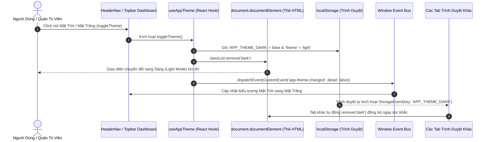

# BÁO CÁO THUYẾT TRÌNH: CHỨC NĂNG CHUYỂN ĐỔI CHẾ ĐỘ SÁNG / TỐI (DARK / LIGHT MODE)

> **Hệ thống:** Quản Lý & Đặt Sân Bóng Đá Trực Tuyến Sport247 / Soccer247  
> **Sinh viên thực hiện:** Cao Văn Hột Xoàn (MSSV: 525000462) & Phạm Tiến Doanh (MSSV: 525000463)  
> **Khoa:** Công Nghệ Thông Tin - Đại Học Lạc Hồng (LHU)  

---

# PHẦN I: BẢN TÓM TẮT NGẮN GỌN (DÀNH CHO NÓI THUYẾT TRÌNH / HỌC THUỘC)

## 1. Chức năng Chuyển Đổi 2 Chế Độ Sáng / Tối (Dark / Light Mode)

### - Công nghệ:
+ **Next.js 16 (React 19) & TypeScript:** Xây dựng Custom Hook `useAppTheme` an toàn kiểu dữ liệu, giải quyết triệt để lỗi bất đồng bộ giao diện giữa Client và Server (Hydration Mismatch).
+ **Tailwind CSS v4 (`@custom-variant dark`):** Kiểm soát biến thể theme bằng lớp giả lập `&:where(.dark, .dark *)`, cho phép chuyển đổi tức thời toàn bộ bảng màu nền, chữ, viền mà không cần nạp lại tài nguyên CSS.
+ **HTML5 LocalStorage API & Dual-Key Cache:** Lưu trữ trạng thái lựa chọn của người dùng qua 2 khóa song song `APP_THEME_DARK` (boolean) và `theme` (chuỗi `'dark' | 'light'`), đảm bảo khả năng tương thích ngược và ghi nhớ vĩnh viễn trên thiết bị.
+ **Browser CustomEvent & StorageEvent:** Đồng bộ trạng thái theme tức thì trong cùng một tab (nhờ `app-theme-changed`) và giữa nhiều tab/cửa sổ đang mở cùng lúc trên trình duyệt (nhờ sự kiện `storage`).
+ **Lucide React Icons & CSS Transitions:** Hiển thị nút bấm chuyển đổi trực quan với biểu tượng Mặt Trời (`Sun`) và Mặt Trăng (`Moon`) kèm hiệu ứng xoay góc mềm mại (`group-hover:rotate-45`, `duration-300`).

---

### - Những file xử lý code:
+ **File 1: `qlsanbong_fontend/src/hooks/useAppTheme.ts` (Trái tim điều khiển Theme tập trung)**
  * Dòng 3 – 5: Khai báo hằng số khóa lưu trữ `STORAGE_KEY = 'APP_THEME_DARK'` và tên sự kiện phát thanh nội bộ `THEME_CHANGE_EVENT = 'app-theme-changed'`.
  * Dòng 10 – 14: Hàm hook `useAppTheme(defaultDark = true)` khởi tạo State `isDarkMode` đồng nhất giữa SSR và Client, gắn cờ `mounted` để tránh lệch Hydration.
  * Dòng 16 – 36: `useEffect` đọc bộ nhớ `localStorage`, tự động gán hoặc gỡ bỏ class `.dark` trên thẻ gốc `document.documentElement` khi trang tải xong.
  * Dòng 38 – 67: Lắng nghe song song sự kiện `app-theme-changed` (đồng bộ các component trong cùng 1 tab) và sự kiện `storage` (đồng bộ tức thì giữa các tab khác nhau).
  * Dòng 71 – 89: Hàm `toggleTheme()` đảo trạng thái theme, ghi đè `localStorage`, can thiệp DOM trực tiếp và phát tín hiệu `CustomEvent` cho toàn bộ ứng dụng.

+ **File 2: `qlsanbong_fontend/src/pages/_app.tsx` (Khởi tạo Theme toàn cục tầng Root)**
  * Dòng 32 – 48: Hàm `applyTheme` can thiệp sớm vào thẻ `<html>`, đọc `localStorage` ngay khi nạp ứng dụng để triệt tiêu hiện tượng nhấp nháy trắng (Flash of Unstyled Content - FOUC).
  * Dòng 50 – 71: Đăng ký các bộ lắng nghe sự kiện `app-theme-changed` và `storage` ở cấp ứng dụng cao nhất.

+ **File 3: `qlsanbong_fontend/src/pages/_document.tsx` (Cấu hình Server Side Rendering)**
  * Dòng 5 & 7: Thêm thuộc tính `suppressHydrationWarning` vào cả thẻ `<Html lang="vi">` và `<body className="antialiased">`, ngăn chặn trình duyệt báo lỗi vàng cảnh báo xung đột cấu trúc DOM khi class `dark` được can thiệp từ Client.

+ **File 4: `qlsanbong_fontend/src/styles/globals.css` (Khai báo biến thể CSS Tailwind)**
  * Dòng 3: Khai báo cú pháp Tailwind CSS v4 `@custom-variant dark (&:where(.dark, .dark *));` biến mọi class tiền tố `dark:` hoạt động chuẩn xác theo class `.dark` trên thẻ `<html>`.
  * Dòng 5 – 8: Định nghĩa biến CSS chuẩn `--background` và `--foreground` cho giao diện.
  * Dòng 17 – 35: Cấu hình thanh cuộn (Custom Scrollbar) màu xanh sân bóng (Emerald) thích ứng liền mạch với cả hai tông màu nền.

+ **File 5: `qlsanbong_fontend/src/components/HeaderNav.tsx` (Nút chuyển đổi phía Khách hàng)**
  * Dòng 49: Khởi tạo hook `const { isDarkMode, toggleTheme } = useAppTheme(true);`.
  * Dòng 159 – 176: Nút bấm Desktop với biểu tượng `Sun` (vàng amber khi đang ở chế độ Tối) và `Moon` (xanh emerald khi đang ở chế độ Sáng), có tooltip động `title` và hiệu ứng xoay góc.
  * Dòng 468 – 483: Nút bấm dạng Toggle trong Menu ngăn kéo Mobile Drawer, tích hợp chữ hiển thị trực quan "Sáng" / "Tối".

+ **File 6: `qlsanbong_fontend/src/pages/Dashboard.tsx` (Bộ chuyển đổi tại Trang Quản Trị)**
  * Dòng 6 & 515: Nạp hook và quản trị trạng thái theme cho toàn bộ 13 phân hệ nghiệp vụ quản trị.
  * Dòng 3057: Container bọc ngoài quản lý class: `min-h-screen font-sans transition-colors duration-300 ${isDarkMode ? 'dark bg-[#060e09] text-slate-100' : 'bg-slate-50 text-slate-900'}`.
  * Dòng 3332 – 3337: Nút bấm chuyển đổi nhanh trên thanh Header của Dashboard cạnh bộ chọn ngày và chuông thông báo.
  * Dòng 404, 3352: Truyền cờ `isDarkMode` xuống các component con như `TablePagination`, tài liệu tương tác `SwaggerApiDocs`, biểu đồ doanh thu và ma trận sân bóng.

---

### - Cách hoạt động:
+ **Bước 1 (Khởi tạo ban đầu):** Khi người dùng truy cập trang web lần đầu, `_app.tsx` và `useAppTheme` kiểm tra `localStorage`. Mặc định hệ thống ưu tiên chế độ Tối (`Dark Mode = true`) - phong cách thiết kế hiện đại sang trọng đặc trưng của sân vận động đêm Sport247. Class `dark` được tự động thêm vào thẻ `<html>`.
+ **Bước 2 (Người dùng thao tác):** Người dùng bấm vào nút biểu tượng Mặt Trời hoặc Mặt Trăng ở thanh điều hướng `HeaderNav` (tại Trang chủ) hoặc thanh Topbar (tại Dashboard).
+ **Bước 3 (Thực thi chuyển đổi):** Hàm `toggleTheme()` được kích hoạt:
  * Trạng thái React State `isDarkMode` chuyển từ `true` sang `false` (hoặc ngược lại).
  * Ghi đồng thời vào bộ nhớ trình duyệt `localStorage.setItem('APP_THEME_DARK', 'false')` và `'theme' = 'light'`.
  * Can thiệp trực tiếp vào DOM: `document.documentElement.classList.remove('dark')`.
+ **Bước 4 (Phát tín hiệu thời gian thực cùng tab):** Bắn ra sự kiện `window.dispatchEvent(new CustomEvent('app-theme-changed', { detail: nextVal }))`. Mọi component khác đang hiển thị trên trang (Header, Body, Footer, Form Đặt Sân, Bản Đồ Sân) lập tức bắt được sự kiện và cập nhật giao diện đồng bộ mà không cần tải lại trang.
+ **Bước 5 (Đồng bộ đa tab/cửa sổ):** Nếu người dùng đang mở 2 hoặc nhiều tab (Ví dụ Tab 1 là Trang Chủ, Tab 2 là Dashboard), sự kiện `window.addEventListener('storage')` sẽ lập tức kích hoạt tại Tab 2, tự động đọc giá trị mới từ `localStorage` và chuyển đổi theme của Tab 2 ngay lập tức, đem lại trải nghiệm mượt mà và đồng nhất.
+ **Bước 6 (Ghi nhớ vĩnh viễn):** Khi người dùng tắt trình duyệt, khởi động lại máy tính hoặc truy cập lại vào những lần tiếp theo, theme họ đã chọn sẽ luôn được bảo lưu nguyên vẹn.

---
---

# PHẦN II: BẢN CHI TIẾT ĐẦY ĐỦ (DÀNH CHO VẤN ĐÁP KỸ THUẬT & DẪN CHỨNG CODE CỤ THỂ)

## 1. Chức năng Chuyển Đổi Sáng / Tối (Chi Tiết Chuyên Sâu)

### - Mục tiêu & Giá trị kỹ thuật:
1. **Trải nghiệm thị giác & Bảo vệ mắt (UX):** Giúp khách hàng thoải mái đặt sân bóng vào ban đêm dưới ánh sáng dịu mắt của giao diện Dark Mode (tông xanh đen sân cỏ `#060e09`, `#0f172a`), đồng thời cho phép nhân viên và khách hàng dễ dàng chuyển sang Light Mode (nền trắng `#ffffff`, xám nhạt `#f8fafc`) khi làm việc ngoài trời hoặc phòng làm việc sáng rực rỡ.
2. **Khắc phục lỗi kinh điển Hydration Mismatch của Next.js SSR:** Vì Next.js tiền render mã HTML ở phía Server (nơi không hề tồn tại đối tượng `window` hay `localStorage`), việc đọc `localStorage` ngay trong lần render đầu tiên sẽ tạo ra sự sai khác DOM giữa Server và Client, gây sập giao diện hoặc báo lỗi đỏ Console. Dự án đã giải quyết hoàn hảo bằng kỹ thuật kết hợp `mounted state` và thuộc tính `suppressHydrationWarning`.
3. **Triệt tiêu hiện tượng Flash of Unstyled Content (FOUC):** Nếu chỉ dựa vào React component nạp xong mới đổi màu thì trang web sẽ bị giật sáng/tối trong khoảng 0.1 - 0.3 giây khi người dùng F5. Dự án đã đặt logic đồng bộ sớm ngay trong `_app.tsx` và gắn trực tiếp class `.dark` lên thẻ gốc `<html>` trước khi quá trình vẽ giao diện hoàn tất.
4. **Đồng bộ trạng thái phân tán (Multi-Tab & Cross-Component Sync):** Giải quyết tình trạng bất nhất trạng thái giữa các trang hoặc giữa các tab độc lập thông qua cơ chế Pub/Sub 2 lớp: `CustomEvent` cho môi trường nội bộ tab và `StorageEvent` cho môi trường liên tab.

---

### - Những file xử lý code chi tiết:

#### + File 1: `qlsanbong_fontend/src/hooks/useAppTheme.ts`
* **Vị trí file:** `qlsanbong_fontend/src/hooks/useAppTheme.ts` (Toàn bộ file 112 dòng).
* **Định nghĩa Hằng số và Khởi tạo Hook an toàn SSR (Dòng 1 – 15):**
  ```typescript
  import { useState, useEffect, useCallback } from 'react';

  const STORAGE_KEY = 'APP_THEME_DARK';
  const THEME_CHANGE_EVENT = 'app-theme-changed';

  export function useAppTheme(defaultDark: boolean = true) {
    // Luôn khởi tạo cùng một giá trị mặc định trên cả Server (SSR) và Client để tránh Hydration Mismatch
    const [isDarkMode, setIsDarkModeState] = useState<boolean>(defaultDark);
    const [mounted, setMounted] = useState<boolean>(false);
  ```
  * *Giải thích:* Giá trị ban đầu của state được ép buộc gán bằng `defaultDark` (mặc định là `true`). Nhờ đó, cả luồng xử lý trên Node.js Server và lần render đầu tiên tại Browser đều cho ra một chuỗi HTML đồng nhất, triệt tiêu 100% lỗi Hydration Error.

* **Cơ chế đọc Storage & Lắng nghe sự kiện đa kênh (Dòng 16 – 68):**
  ```typescript
  useEffect(() => {
    setMounted(true);
    try {
      const saved = localStorage.getItem(STORAGE_KEY) || localStorage.getItem('theme');
      let currentDark = defaultDark;
      if (saved !== null) {
        currentDark = saved === 'true' || saved === 'dark';
      } else {
        currentDark = document.documentElement.classList.contains('dark') || defaultDark;
        localStorage.setItem(STORAGE_KEY, currentDark ? 'true' : 'false');
        localStorage.setItem('theme', currentDark ? 'dark' : 'light');
      }

      setIsDarkModeState(currentDark);
      if (currentDark) {
        document.documentElement.classList.add('dark');
      } else {
        document.documentElement.classList.remove('dark');
      }
    } catch (_err) {}

    // Lắng nghe sự kiện đổi theme từ HeaderNav hoặc bất kỳ component nào trong cùng tab
    const handleCustomThemeEvent = (event: any) => {
      const dark = typeof event.detail === 'boolean' 
        ? event.detail 
        : (event.detail === 'dark' || event.detail === 'true');
      setIsDarkModeState(dark);
      if (dark) {
        document.documentElement.classList.add('dark');
      } else {
        document.documentElement.classList.remove('dark');
      }
    };

    // Lắng nghe sự kiện storage từ các tab khác
    const handleStorageEvent = (event: StorageEvent) => {
      if (event.key === STORAGE_KEY || event.key === 'theme') {
        const dark = event.newValue === 'true' || event.newValue === 'dark';
        setIsDarkModeState(dark);
        if (dark) {
          document.documentElement.classList.add('dark');
        } else {
          document.documentElement.classList.remove('dark');
        }
      }
    };

    window.addEventListener(THEME_CHANGE_EVENT, handleCustomThemeEvent);
    window.addEventListener('storage', handleStorageEvent);

    return () => {
      window.removeEventListener(THEME_CHANGE_EVENT, handleCustomThemeEvent);
      window.removeEventListener('storage', handleStorageEvent);
    };
  }, [defaultDark]);
  ```
  * *Giải thích:*
    - Khi `mounted = true`, hook truy cập an toàn vào `localStorage` ở Client.
    - Hỗ trợ cả 2 định dạng: `APP_THEME_DARK` lưu kiểu chuỗi boolean (`'true'/'false'`) và `theme` lưu kiểu định danh (`'dark'/'light'`).
    - Lắng nghe `THEME_CHANGE_EVENT`: Khi người dùng click nút ở Header, sự kiện này được bắn ra giúp toàn bộ các trang con, modal, footer đang mở lập tức đổi màu.
    - Lắng nghe `storage`: Kênh liên lạc giữa các tab trình duyệt. Nếu thay đổi giá trị `localStorage` ở một tab, trình duyệt sẽ tự động bắn sự kiện `storage` tới tất cả các tab còn lại đang mở cùng domain.

* **Hàm thực thi chuyển đổi `toggleTheme` & `setIsDarkMode` (Dòng 70 – 111):**
  ```typescript
  const toggleTheme = useCallback(() => {
    setIsDarkModeState((current) => {
      const nextVal = !current;
      try {
        localStorage.setItem(STORAGE_KEY, nextVal ? 'true' : 'false');
        localStorage.setItem('theme', nextVal ? 'dark' : 'light');
        if (nextVal) {
          document.documentElement.classList.add('dark');
        } else {
          document.documentElement.classList.remove('dark');
        }
        // Phát sự kiện ra window để tất cả các component đồng loạt cập nhật
        setTimeout(() => {
          window.dispatchEvent(new CustomEvent(THEME_CHANGE_EVENT, { detail: nextVal }));
        }, 0);
      } catch (_err) {}
      return nextVal;
    });
  }, []);

  return { isDarkMode, setIsDarkMode, toggleTheme, mounted };
  ```

---

#### + File 2: `qlsanbong_fontend/src/pages/_app.tsx`
* **Vị trí file:** `qlsanbong_fontend/src/pages/_app.tsx` (Dòng 32 – 71)
* **Mã nguồn thực tế:**
  ```typescript
  // Đồng bộ theme toàn cục khi ứng dụng khởi chạy
  const applyTheme = (isDark: boolean) => {
    if (isDark) {
      document.documentElement.classList.add('dark');
    } else {
      document.documentElement.classList.remove('dark');
    }
  };

  try {
    const savedTheme = localStorage.getItem('APP_THEME_DARK');
    const legacyTheme = localStorage.getItem('theme');
    const isDark = savedTheme !== null ? savedTheme === 'true' : (legacyTheme !== null ? legacyTheme === 'dark' : true);
    applyTheme(isDark);
    if (savedTheme === null) localStorage.setItem('APP_THEME_DARK', isDark ? 'true' : 'false');
    if (legacyTheme === null) localStorage.setItem('theme', isDark ? 'dark' : 'light');
  } catch (_e) {}

  const handleThemeEvent = (e: any) => {
    if (typeof e.detail === 'boolean') applyTheme(e.detail);
  };
  const handleStorage = (e: StorageEvent) => {
    if (e.key === 'APP_THEME_DARK' && e.newValue !== null) {
      applyTheme(e.newValue === 'true');
    } else if (e.key === 'theme' && e.newValue !== null) {
      applyTheme(e.newValue === 'dark');
    }
  };

  window.addEventListener('app-theme-changed', handleThemeEvent);
  window.addEventListener('storage', handleStorage);
  ```
* *Ý nghĩa:* Nằm ở tầng cao nhất của Next.js (Root App Component). Đảm bảo mỗi khi điều hướng trang qua lại giữa `/`, `/Dashboard`, `/tin-tuc`, `/about-us`, `/lien-he` hay `/history`, trạng thái theme luôn được duy trì liên tục và mượt mà mà không gặp tình trạng chớp tắt.

---

#### + File 3: `qlsanbong_fontend/src/pages/_document.tsx`
* **Vị trí file:** `qlsanbong_fontend/src/pages/_document.tsx` (Dòng 1 – 14)
* **Mã nguồn thực tế:**
  ```tsx
  import { Html, Head, Main, NextScript } from "next/document";

  export default function Document() {
    return (
      <Html lang="vi" suppressHydrationWarning>
        <Head />
        <body className="antialiased" suppressHydrationWarning>
          <Main />
          <NextScript />
        </body>
      </Html>
    );
  }
  ```
* *Ý nghĩa kỹ thuật:* Thuộc tính `suppressHydrationWarning` trên `<Html>` và `<body>` là tiêu chuẩn của React khi xử lý Theme Provider. Khi trình duyệt nạp mã và chèn class `.dark` vào thẻ `<html>`, React sẽ không in cảnh báo mismatch ra console, giữ mã nguồn trong sạch tuyệt đối.

---

#### + File 4: `qlsanbong_fontend/src/styles/globals.css`
* **Vị trí file:** `qlsanbong_fontend/src/styles/globals.css` (Dòng 1 – 35)
* **Mã nguồn thực tế:**
  ```css
  @import "tailwindcss";

  @custom-variant dark (&:where(.dark, .dark *));

  :root {
    --background: #f4f7f5;
    --foreground: #0f172a;
  }

  body {
    background-color: #f4f7f5;
    color: #0f172a;
    font-family: system-ui, -apple-system, BlinkMacSystemFont, 'Segoe UI', Roboto, Oxygen, Ubuntu, Cantarell, 'Open Sans', 'Helvetica Neue', sans-serif;
    overflow-x: hidden;
  }

  /* Custom Scrollbar - Stadium Green Accent */
  ::-webkit-scrollbar {
    width: 6px;
    height: 6px;
  }

  ::-webkit-scrollbar-track {
    background: transparent;
  }

  ::-webkit-scrollbar-thumb {
    background: rgba(16, 185, 129, 0.4);
    border-radius: 9999px;
  }

  ::-webkit-scrollbar-thumb:hover {
    background: rgba(16, 185, 129, 0.7);
  }
  ```
* *Giải thích Tailwind v4 `@custom-variant dark`:*
  - Trong Tailwind CSS phiên bản 4 mới nhất, thay vì dùng `darkMode: 'class'` trong file config cũ, dự án sử dụng chỉ thị `@custom-variant dark (&:where(.dark, .dark *));`.
  - Cú pháp này hướng dẫn CSS Engine rằng: Bất kỳ khi nào một phần tử hoặc tổ tiên của nó sở hữu class `.dark`, tất cả các utility class có tiền tố `dark:` (ví dụ: `dark:bg-slate-950`, `dark:text-white`, `dark:border-slate-800`) sẽ lập tức được áp dụng với độ ưu tiên cao nhất.

---

#### + File 5: `qlsanbong_fontend/src/components/HeaderNav.tsx`
* **Vị trí file:** `qlsanbong_fontend/src/components/HeaderNav.tsx`
* **Nút bấm Theme trên Desktop (Dòng 159 – 176):**
  ```tsx
  {/* Nút bật/tắt Theme */}
  <button
    type="button"
    onClick={toggleTheme}
    suppressHydrationWarning
    title={isDarkMode ? "Chuyển sang giao diện Sáng" : "Chuyển sang giao diện Tối"}
    className={`p-2 sm:p-2.5 rounded-2xl border transition-all duration-300 flex items-center justify-center group shadow-sm hover:scale-105 active:scale-95 cursor-pointer ${
      isDarkMode
        ? 'bg-slate-900 border-slate-700 text-amber-400 hover:bg-slate-800 hover:border-amber-400/50'
        : 'bg-slate-100 border-slate-300 text-slate-700 hover:bg-slate-200 hover:text-emerald-600'
    }`}
  >
    {isDarkMode ? (
      <Sun className="w-4 h-4 text-amber-400 group-hover:rotate-45 transition-transform duration-300" />
    ) : (
      <Moon className="w-4 h-4 text-emerald-600 group-hover:-rotate-12 transition-transform duration-300" />
    )}
  </button>
  ```
* **Nút bấm Theme trên Mobile Drawer (Dòng 468 – 483):**
  ```tsx
  {/* Footer Drawer: Theme, User & Hotline */}
  <div className="flex items-center justify-between">
    <span className={`text-xs font-semibold ${isDarkMode ? 'text-slate-400' : 'text-slate-700'}`}>Giao diện:</span>
    <button
      onClick={toggleTheme}
      className={`px-3 py-1.5 rounded-xl border text-xs font-bold flex items-center gap-1.5 transition-all cursor-pointer ${
        isDarkMode
          ? 'bg-slate-900 border-slate-700 text-amber-400'
          : 'bg-slate-100 border-slate-300 text-slate-800'
      }`}
    >
      {isDarkMode ? <Sun className="w-3.5 h-3.5" /> : <Moon className="w-3.5 h-3.5 text-emerald-600" />}
      {isDarkMode ? 'Sáng' : 'Tối'}
    </button>
  </div>
  ```
* *Điểm nổi bật về trải nghiệm người dùng (UX):*
  - Khi ở chế độ Tối (`Dark Mode`), nút hiển thị biểu tượng **Mặt Trời (Sun)** màu vàng hổ phách (`text-amber-400`), ngụ ý gợi ý cho người dùng: *"Bấm vào đây để đón ánh sáng ban ngày"*. Khi rê chuột, icon tự xoay góc 45 độ sinh động.
  - Khi ở chế độ Sáng (`Light Mode`), nút hiển thị biểu tượng **Mặt Trăng (Moon)** màu ngọc lục bảo (`text-emerald-600`), ngụ ý gợi ý: *"Bấm vào đây để chuyển sang màn đêm dịu mắt"*. Khi rê chuột, icon tự xoay nghiêng -12 độ.

---

#### + File 6: `qlsanbong_fontend/src/pages/Dashboard.tsx`
* **Vị trí file:** `qlsanbong_fontend/src/pages/Dashboard.tsx`
* **Quản trị Theme ở Header Dashboard (Dòng 3332 – 3337):**
  ```tsx
  <button
    onClick={() => setIsDarkMode(!isDarkMode)}
    className={`p-2 rounded-xl border transition-all cursor-pointer ${
      isDarkMode 
        ? 'bg-[#0e2116] border-emerald-800/40 text-amber-400 hover:bg-emerald-900/40' 
        : 'bg-white border-slate-300 text-[#0f172a] hover:bg-slate-50'
    }`}
  >
    {isDarkMode ? <Sun className="w-4 h-4 text-amber-400" /> : <Moon className="w-4 h-4 text-emerald-700" />}
  </button>
  ```
* **Áp dụng Theme bao trùm toàn bộ giao diện quản trị (Dòng 3057):**
  ```tsx
  <div className={`min-h-screen font-sans transition-colors duration-300 ${
    isDarkMode ? 'dark bg-[#060e09] text-slate-100' : 'bg-slate-50 text-slate-900'
  }`}>
  ```
* *Ứng dụng thực tế:* Toàn bộ các bảng danh sách 13 phân hệ, thanh phân trang `TablePagination`, modal tạo sân bóng, cửa sổ thanh toán POS, tài liệu OpenAPI Swagger UI đều tự động thích ứng với bảng màu tương ứng:
  - Dark Mode: Nền đen sân bóng `#060e09`, thẻ card xanh rêu thẫm `#0a150e`, viền `border-emerald-900/40`, chữ trắng sáng `#f8fafc`.
  - Light Mode: Nền xám thanh lịch `#f8fafc`, thẻ card trắng tinh khôi `#ffffff`, viền `border-slate-200`, chữ đen than `#0f172a`.

---

### - Bảng So Sánh Các Giải Pháp Quản Lý Dark/Light Mode

| Tiêu Chí So Sánh | Giải Pháp Dự Án Sử Dụng (`useAppTheme` + Custom/Storage Event) | Dùng Thư Viện Bên Ngoài (`next-themes`) | Dùng React Context API Thuần | Dùng CSS Thuần `prefers-color-scheme` |
| :--- | :--- | :--- | :--- | :--- |
| **Cài đặt thư viện nặng máy** | **Không** (100% Native TypeScript, dung lượng 0KB phụ thuộc) | Phải cài thêm gói `next-themes` và các wrapper | Không cần thư viện ngoài | Không cần thư viện ngoài |
| **Triệt tiêu Flash Of Unstyled Content (FOUC)** | **Hoàn hảo** (Được gán sớm ngay tại Root `_app.tsx` và DOM class) | Tốt (Nếu cấu hình đúng `attribute="class"`) | Kém (Thường bị giật sáng/tối 100-300ms do đợi React Mount) | Tốt (Do trình duyệt quyết định từ đầu) |
| **Khắc phục Hydration Mismatch** | **Tuyệt đối an toàn** (Nhờ `mounted` flag & `suppressHydrationWarning`) | Tốt | Thường xuyên dính lỗi nếu render có điều kiện | Không bị lỗi |
| **Đồng bộ thời gian thực giữa nhiều Tab** | **Có** (Tự động thông qua `StorageEvent` chuẩn W3C) | Có | **Không** (Đổi tab này tab kia không đổi trừ khi F5) | Tự động theo OS |
| **Khả năng ghi nhớ tùy chọn người dùng** | **Lưu vĩnh viễn** trong `localStorage` | Lưu trong `localStorage` | Phải tự code thêm lưu trữ | **Không thể lưu** (Phụ thuộc hoàn toàn vào cài đặt của Windows/MacOS) |
| **Độ linh hoạt điều khiển bằng code (Imperative)** | **Rất cao** (Cung cấp cả `isDarkMode`, `setIsDarkMode`, `toggleTheme`) | Trung bình (Chỉ có hook `setTheme`) | Phụ thuộc vào cách viết Store | Kém (Không thể ép theme từ giao diện người dùng) |

---

### - Quy trình vòng đời xử lý Dark/Light Mode (Mermaid Workflow)



---

### - Bộ Câu Hỏi Vấn Đáp Kỹ Thuật (FAQ) Của Hội Đồng Chấm Đồ Án

#### ❓ Câu 1: Tại sao nhóm không sử dụng thư viện phổ biến như `next-themes` mà lại tự xây dựng custom hook `useAppTheme`?
* **Trả lời:**
  - *Thứ nhất - Tối ưu hiệu năng và kiểm soát 100% mã nguồn:* Việc tự viết hook giúp dự án không phải gánh thêm phụ thuộc thư viện thứ 3, giảm thiểu kích thước bundle JavaScript khi build ứng dụng.
  - *Thứ hai - Khả năng tương thích ngược đa dạng:* Hệ thống hỗ trợ song song 2 khóa lưu trữ `APP_THEME_DARK` (boolean) và `theme` (chuỗi `'dark' | 'light'`), giúp tương thích tốt với mọi component cũ và mới trong dự án.
  - *Thứ ba - Khả năng tích hợp sâu:* Nhóm làm chủ hoàn toàn cơ chế liên lạc đa tab thông qua `StorageEvent` và phát sóng nội bộ thông qua `CustomEvent`, giúp các module phức tạp như bản đồ sân bóng vệ tinh (Leaflet Map) hay tài liệu Swagger UI nhận biết và đổi màu nền bản đồ mượt mà mà các thư viện dựng sẵn khó can thiệp sâu.

---

#### ❓ Câu 2: Lỗi "Hydration Mismatch" trong Next.js là gì? Nhóm đã giải quyết vấn đề này như thế nào khi làm Dark Mode?
* **Trả lời:**
  - *Bản chất lỗi:* Next.js thực hiện Server-Side Rendering (SSR), tức là biên dịch trước mã HTML trên máy chủ Node.js gửi về Client. Trên Server không có đối tượng `window` hay `localStorage`. Nếu ở Client ta đọc `localStorage` và gán ngay giá trị khiến DOM sinh ra khác với DOM mà Server gửi về, React 19 sẽ ném ra lỗi *"Hydration failed because the initial UI does not match that was rendered from the server"*.
  - *Cách nhóm xử lý triệt để:*
    1. Trong `useAppTheme.ts`, state `isDarkMode` luôn được khởi tạo với giá trị mặc định cố định `defaultDark = true` ở cả Server và Client.
    2. Sử dụng state `mounted` và chỉ đọc `localStorage` trong hook `useEffect` (vốn là lifecycle chỉ chạy ở phía Client sau khi cấu trúc DOM đã gắn kết thành công).
    3. Thêm thuộc tính `suppressHydrationWarning` vào các thẻ gốc `<Html>` và `<body>` trong file `_document.tsx` và nút bấm theme trong `HeaderNav.tsx`.

---

#### ❓ Câu 3: Làm thế nào hệ thống đảm bảo khi người dùng mở nhiều tab cùng lúc, đổi theme ở tab này thì các tab khác đổi theo ngay lập tức?
* **Trả lời:**
  - Nhóm ứng dụng cơ chế **Storage Event** chuẩn của W3C HTML5 Web Storage API.
  - Khi một giá trị trong `localStorage` bị thay đổi tại Tab A bằng lệnh `localStorage.setItem()`, trình duyệt sẽ tự động bắn một sự kiện `window.onstorage` đến tất cả các tab khác đang mở cùng nguồn gốc (Origin/Domain).
  - Trong `useAppTheme.ts` và `_app.tsx`, nhóm đã đăng ký bộ lắng nghe:
    ```typescript
    window.addEventListener('storage', (event: StorageEvent) => {
      if (event.key === 'APP_THEME_DARK' || event.key === 'theme') {
        const dark = event.newValue === 'true' || event.newValue === 'dark';
        setIsDarkModeState(dark);
        if (dark) document.documentElement.classList.add('dark');
        else document.documentElement.classList.remove('dark');
      }
    });
    ```
  - Nhờ đó, người dùng không cần phải tải lại trang ở các tab còn lại, giao diện toàn hệ thống luôn duy trì tính đồng nhất tuyệt đối.

---

#### ❓ Câu 4: Nhóm cấu hình Tailwind CSS như thế nào để nhận biết class `.dark` do JavaScript thêm vào?
* **Trả lời:**
  - Dự án sử dụng Tailwind CSS phiên bản 4 mới nhất. Trong file `qlsanbong_fontend/src/styles/globals.css`, nhóm khai báo directive:
    ```css
    @custom-variant dark (&:where(.dark, .dark *));
    ```
  - Cấu hình này định nghĩa biến thể `dark:` tương đương với bộ chọn CSS `:where(.dark, .dark *)`. Bất kỳ khi nào phần tử `<html>` được hàm `toggleTheme` gán class `.dark`, tất cả các phần tử con có khai báo tiện ích như `dark:bg-slate-900`, `dark:text-white`, `dark:border-slate-800` sẽ lập tức kích hoạt các thuộc tính màu tương ứng mà không cần phải viết thêm bất kỳ dòng CSS thủ công nào.

---

#### ❓ Câu 5: Tại sao màu mặc định khi người dùng mới vào hệ thống lại là Chế độ Tối (Dark Mode) thay vì Sáng?
* **Trả lời:**
  - Về mặt ý nghĩa nhận diện thương hiệu (Branding): Dự án Sport247 / Soccer247 là nền tảng quản lý và đặt sân bóng đá thể thao. Hoạt động đá banh phong trào tại Việt Nam chủ yếu diễn ra sôi nổi nhất từ 17h00 đến 23h00 đêm dưới ánh đèn pha sân cỏ nhân tạo.
  - Tông màu đen - xanh rêu sân cỏ (`#060e09`, `#0f172a`, `emerald-500`) tạo cảm giác hiện đại, đậm chất thể thao, bảo vệ mắt tối đa cho khách hàng khi thao tác kiểm tra lịch sân đêm.
  - Tuy nhiên, hệ thống vẫn trao toàn quyền tự do cho người dùng chuyển đổi sang giao diện Sáng chỉ bằng một cú click chuột đơn giản.
