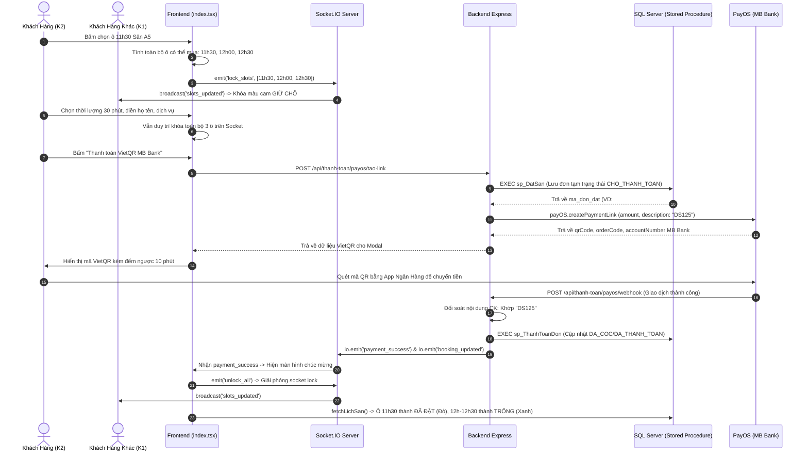

# TÀI LIỆU TOÀN DIỆN VỀ CHỨC NĂNG ĐẶT SÂN & THANH TOÁN TẠI TRANG CHỦ

> **Dành cho:** Báo cáo, thuyết trình, vấn đáp đồ án tốt nghiệp  
> **Hệ thống:** Quản Lý & Đặt Sân Bóng Đá Trực Tuyến Sport247  
> **Cập nhật ngày:** 23/10/2026  

---

## MỤC LỤC
1. [Lời Giải Thích Tổng Quan (Dành Cho Thuyết Trình)](#1-lời-giải-thích-tổng-quan)
2. [Công Nghệ Sử Dụng (Tech Stack)](#2-công-nghệ-sử-dụng)
3. [Cơ Chế Khóa Giữ Chỗ Real-Time Chống Xung Đột (Race Condition)](#3-cơ-chế-khóa-giữ-chỗ-real-time)
4. [Sơ Đồ & Luồng Hoạt Động Chi Tiết (End-to-End Workflow)](#4-sơ-đồ--luồng-hoạt-động-chi-tiết)
5. [Danh Sách Các File Code Cụ Thể](#5-danh-sách-các-file-code-cụ-thể)
6. [Chi Tiết Các Dòng Code Quan Trọng & Giải Thích Dễ Hiểu](#6-chi-tiết-các-dòng-code-quan-trọng)
7. [Các Kịch Bản Xử Lý Ngoại Lệ & An Toàn Dữ Liệu](#7-các-kịch-bản-xử-lý-ngoại-lệ)

---

## 1. LỜI GIẢI THÍCH TỔNG QUAN

### 1.1 Mục tiêu chức năng
Chức năng **Đặt Sân & Thanh Toán Trực Tuyến tại Trang Chủ** cho phép khách hàng:
- Xem trực quan **ma trận lịch sân** theo thời gian thực (Real-time Grid): biết chính xác ô nào **TRỐNG (xanh)**, ô nào **ĐANG GIỮ CHỖ (cam)**, ô nào **ĐÃ ĐẶT (đỏ)**, ô nào **ĐÃ QUA GIỜ (xám)**.
- Chọn giờ bắt đầu, lựa chọn các mốc thời lượng đá linh hoạt (**30 phút, 1 tiếng, 1 tiếng 30 phút, 2 tiếng**).
- Đặt thêm các dịch vụ tiện ích đi kèm (nước suối, nước ngọt, áo bib, trọng tài, bóng thi đấu).
- Tự động thanh toán chuyển khoản qua mã **VietQR chuẩn Napas 247 kết nối ngân hàng Quân Đội MB Bank** thông qua cổng **PayOS**.
- Hệ thống tự động xác nhận **ngay khi tiền vào tài khoản ngân hàng** (trong vòng 1 - 3 giây) qua Webhook mà **không cần nhân viên duyệt thủ công** hay bắt khách chụp lại bill chuyển khoản.

---

## 2. CÔNG NGHỆ SỬ DỤNG

| Lớp kiến trúc | Công nghệ sử dụng | Vai trò trong chức năng |
| :--- | :--- | :--- |
| **Frontend UI** | **Next.js (React) + TypeScript** | Xây dựng giao diện ma trận lịch sân, modal đặt lịch 3 bước, form nhập liệu. |
| **Styling** | **Tailwind CSS + Lucide Icons** | Tạo hiệu ứng thị giác hiện đại (Dark/Light mode, màu trạng thái ô sân, animation ping giữ chỗ). |
| **Real-time Engine** | **Socket.IO (Client & Server)** | Đồng bộ tức thời mili-giây trạng thái giữ chỗ giữa hàng ngàn người dùng cùng lúc. |
| **Backend API** | **Node.js + Express + TypeScript** | Xử lý nghiệp vụ đặt sân, kiểm tra xung đột thời gian, tạo link VietQR, hứng Webhook ngân hàng. |
| **Cổng Thanh Toán** | **PayOS SDK (`@payos/node`)** | Tích hợp Open Banking với **MB Bank** (Ngân hàng TMCP Quân Đội), tự động sinh mã VietQR động theo chuẩn Napas 247. |
| **Cơ Sở Dữ Liệu** | **Microsoft SQL Server 2022** | Lưu trữ toàn bộ dữ liệu sân, đơn đặt, dịch vụ, hóa đơn thanh toán. |
| **Tầng Logic Dữ Liệu** | **100% Stored Procedures** | Đảm bảo an toàn giao dịch `ACID`, dùng `sp_DatSan`, `sp_ThemNguoiDung`, `sp_ThanhToanDon`. |

---

## 3. CƠ CHẾ KHÓA GIỮ CHỖ REAL-TIME

### 3.1 Vấn đề xung đột (Race Condition) thường gặp
Nếu 2 khách hàng (Khách 1 và Khách 2) cùng nhìn thấy ô `11h30` sân A5 còn trống và cùng click vào đặt: nếu không có cơ chế giữ chỗ tức thời, cả 2 sẽ cùng chuyển khoản cho một khung giờ dẫn đến tranh chấp sân.

### 3.2 Giải pháp Socket.IO In-Memory Locking
1. **Lưu trữ trên RAM máy chủ (`lockedSlots Map`)**:
   - Khi Khách 2 click vào ô `11h30`, máy chủ backend lưu khóa theo cấu trúc:
     `Key: "2026-10-23_1_11:30" -> Value: socket.id của Khách 2`.
   - Máy chủ broadcast danh sách này cho toàn bộ client qua sự kiện `slots_updated`.
2. **Khóa toàn bộ các ô trong mục lựa chọn**:
   - Từ ô bắt đầu `11h30`, các mức thời lượng mà Khách 2 **có thể mua** là `30p (11:30 - 12:00)`, `60p (11:30 - 12:30)`, `90p (11:30 - 13:00)`.
   - Hệ thống phát tín hiệu khóa **đồng loạt cả 3 ô**: `11h30`, `12h00`, `12h30`.
   - **Đặc biệt**: Dù Khách 2 đang click chọn nút `30 Phút` hay `1 Tiếng` trong modal, bên giao diện Khách 1 **vẫn hiển thị màu cam "GIỮ CHỖ" cho toàn bộ 3 ô này**. Khách 1 không thể click vào cướp slot sau lưng Khách 2.
3. **Cơ chế tự giải phóng an toàn**:
   - Khi Khách 2 **đóng modal / bấm hủy**: Socket gửi `unlock_all` -> các ô lập tức trở lại màu xanh `TRỐNG`.
   - Khi Khách 2 **tắt trình duyệt / mất mạng**: Sự kiện `disconnect` trên backend tự động dọn dẹp các ô do socket đó nắm giữ.
   - Khi Khách 2 **thanh toán thành công**: Đơn lưu vào CSDL (`DA_DAT`), sau đó `unlock_all` nhả socket lock, ô đặt thành màu đỏ, các ô thừa trở về màu xanh `TRỐNG`.

---

## 4. SƠ ĐỒ & LUỒNG HOẠT ĐỘNG CHI TIẾT



---

## 5. DANH SÁCH CÁC FILE CODE CỤ THỂ

| STT | File Code | Đường dẫn tương đối | Nhiệm vụ chính |
| :---: | :--- | :--- | :--- |
| **1** | `index.tsx` | `qlsanbong_fontend/src/pages/index.tsx` | Giao diện ma trận lịch sân, modal 3 bước đặt lịch, bắt sự kiện click slot, kết nối Socket.IO real-time. |
| **2** | `server.ts` | `qlsanbong_backend/server.ts` | Máy chủ Node.js/Express, cấu hình Socket.IO, lưu trữ `lockedSlots Map` trên RAM, broadcast giữ chỗ. |
| **3** | `thanhToanRoutes.ts` | `qlsanbong_backend/src/routes/thanhToanRoutes.ts` | Định nghĩa các endpoints: `/payos/tao-link`, `/payos/webhook`, `/payos/huy-don-tam`. |
| **4** | `thanhToanController.ts` | `qlsanbong_backend/src/controllers/thanhToanController.ts` | Hàm điều khiển `taoThanhToanPayOS`, `xuLyWebhookPayOS`, gọi Stored Procedure và PayOS SDK. |
| **5** | `ThuTuc.sql` | `Data SQL server 2022/ThuTuc.sql` | Chứa 100% Stored Procedures: `sp_DatSan`, `sp_ThanhToanDon`, `sp_ThemNguoiDung`. |

---

## 6. CHI TIẾT CÁC DÒNG CODE QUAN TRỌNG

### 6.1 Frontend: Xử lý click ô và khóa toàn bộ các ô có thể mua
- **File:** `qlsanbong_fontend/src/pages/index.tsx`
- **Dòng:** `1150 - 1195`

```typescript
// 1. Tìm mức thời lượng tối đa khả dụng không bị xung đột (120p, 90p, 60p, 30p)
let maxHoldDuration = 30;
if (!checkConflictForSan(san.id, slot.start, 120)) {
  maxHoldDuration = 120;
} else if (!checkConflictForSan(san.id, slot.start, 90)) {
  maxHoldDuration = 90;
} else if (!checkConflictForSan(san.id, slot.start, 60)) {
  maxHoldDuration = 60;
} else {
  maxHoldDuration = 30;
}

// 2. Tạo mảng key cho toàn bộ các ô thuộc khoảng thời gian tối đa này
const holdTotalSlots = Math.ceil(maxHoldDuration / 30);
const holdSlotKeys: string[] = [];
let curHoldTime = slot.start;
for (let i = 0; i < holdTotalSlots; i++) {
  holdSlotKeys.push(`${filterNgayDa}_${san.id}_${curHoldTime}`);
  curHoldTime = addMinutesToTime(curHoldTime, 30);
}

// 3. Khóa đồng loạt trên Socket.IO Real-time cho toàn bộ client
socketRef.current?.emit('lock_slots', holdSlotKeys);
setMyLockedSlotIds(holdSlotKeys);

// 4. Mở modal bước 1 và lưu holdSlotKeys vào state
setSelectedSlot({
  san,
  slot,
  durationMin: 30, // Mặc định hiển thị mức 30 phút
  gioKetThuc: addMinutesToTime(slot.start, 30),
  giaTien: 30 * Number(san.don_gia_phut),
  holdSlotKeys, // Bảo toàn danh sách ô khả dụng
});
```
> **Ý nghĩa:** Khi khách bấm ô 11h30, nếu các ô 12h, 12h30 trống thì hệ thống khóa cả 3 ô trên mạng socket để giữ trọn vẹn dải thời gian mà khách có quyền chọn.

---

### 6.2 Frontend: Chọn thời lượng mà vẫn khóa tất cả các ô khả dụng
- **File:** `qlsanbong_fontend/src/pages/index.tsx`
- **Dòng:** `1207 - 1240`

```typescript
const handleSelectDuration = (durationMin: number) => {
  if (!selectedSlot) return;
  
  // Dù khách chọn 30p, 60p hay 90p, vẫn giữ khóa TOÀN BỘ các ô khả dụng
  const activeHoldKeys = (selectedSlot.holdSlotKeys && selectedSlot.holdSlotKeys.length > 0)
    ? selectedSlot.holdSlotKeys
    : myLockedSlotIds;

  // Phát tín hiệu giữ nguyên danh sách khóa lên Socket.IO
  socketRef.current?.emit('lock_slots', activeHoldKeys);
  setMyLockedSlotIds(activeHoldKeys);

  // Chỉ thay đổi thông tin giờ kết thúc và giá tiền trên giao diện
  setSelectedSlot({
    ...selectedSlot,
    durationMin,
    gioKetThuc: addMinutesToTime(selectedSlot.slot.start, durationMin),
    giaTien: durationMin * Number(selectedSlot.san.don_gia_phut),
  });
};
```
> **Ý nghĩa:** Khắc phục triệt để lỗi khách 2 chọn 30 phút làm nhả ô 12h00 và 12h30 cho khách 1 cướp mất.

---

### 6.3 Backend: Quản lý khóa giữ chỗ trên RAM (Socket.IO)
- **File:** `qlsanbong_backend/server.ts`
- **Dòng:** `147 - 174`

```typescript
// Map lưu trữ: Key = slotId ("2026-10-23_1_11:30"), Value = socket.id
const lockedSlots = new Map<string, string>();

socket.on('lock_slots', (slotIds: string[]) => {
    if (!Array.isArray(slotIds) || slotIds.length === 0) return;

    // Xóa các ô cũ do chính socket này đang giữ trước đó
    for (const [id, holderId] of lockedSlots.entries()) {
        if (holderId === socket.id) {
            lockedSlots.delete(id);
        }
    }

    // Đưa danh sách các ô mới vào Map
    slotIds.forEach((slotId) => {
        if (slotId && !lockedSlots.has(slotId)) {
            lockedSlots.set(slotId, socket.id);
        }
    });

    // Broadcast danh sách toàn bộ các ô đang bị khóa cho tất cả các máy khách
    io.emit('slots_updated', Array.from(lockedSlots.keys()));
});
```

---

### 6.4 Backend: Gọi Stored Procedure `sp_DatSan` và sinh mã VietQR PayOS
- **File:** `qlsanbong_backend/src/controllers/thanhToanController.ts`
- **Dòng:** `205 - 265`

```typescript
// 1. Thực thi Stored Procedure sp_DatSan lưu đơn tạm trạng thái 'CHO_THANH_TOAN'
const datSanResult = await pool.request()
    .input('ma_nguoi_dung', sql.Int, ma_nd)
    .input('ma_san', sql.Int, parseInt(ma_san, 10))
    .input('ngay_da', sql.Date, ngay_da)
    .input('gio_bat_dau', sql.VarChar(8), gio_bd_clean)
    .input('gio_ket_thuc', sql.VarChar(8), gio_kt_clean)
    .input('tien_san', sql.Decimal(10, 2), tien_san)
    .input('tong_tien', sql.Decimal(10, 2), tong_tien)
    .input('phuong_thuc', sql.VarChar(20), 'CHUYEN_KHOAN')
    .input('trang_thai', sql.VarChar(20), 'CHO_THANH_TOAN')
    .input('ghi_chu', sql.NVarChar(sql.MAX), `PayOS VietQR MB Bank - ${isTraHet ? '100%' : '30%'}`)
    .execute('sp_DatSan');

const finalDonDatId = datSanResult.recordset[0].id;

// 2. Nội dung chuyển khoản chuẩn hóa: DS + Mã đơn đặt (VD: DS125)
const orderCode = Number(String(Date.now()).slice(-6) + Math.floor(Math.random() * 90 + 10));
const description = `DS${finalDonDatId}`.slice(0, 25);

// 3. Gọi PayOS SDK tạo mã VietQR liên kết MB Bank
const paymentResult = await payOS.createPaymentLink({
    orderCode,
    amount,
    description,
    cancelUrl: `${frontendUrl}/?payment=cancel`,
    returnUrl: `${frontendUrl}/?payment=success`,
    items: [{ name: `Dat san #${finalDonDatId}`, quantity: 1, price: amount }]
});
```

---

### 6.5 CSDL SQL Server: Stored Procedure `sp_DatSan`
- **File:** `Data SQL server 2022/ThuTuc.sql`
- **Dòng:** `1175 - 1186`

```sql
INSERT INTO Don_Dat_San (
    ma_nguoi_dung, ma_san, ngay_da, gio_bat_dau, gio_ket_thuc, 
    tien_san, tong_tien, phuong_thuc, ghi_chu, trang_thai, ngay_tao
)
VALUES (
    @ma_nguoi_dung, @ma_san, @ngay_da, @gio_bat_dau, @gio_ket_thuc, 
    @gia_tinh_duoc, @tong_tien_final, @phuong_thuc, @ghi_chu, @trang_thai, GETDATE()
);

DECLARE @ma_don_moi INT = SCOPE_IDENTITY();
COMMIT TRANSACTION;
```

---

### 6.6 CSDL SQL Server: Stored Procedure `sp_ThanhToanDon`
- **File:** `Data SQL server 2022/ThuTuc.sql`
- **Dòng:** `1647 - 1666`

```sql
-- 1. Lưu bản ghi thanh toán vào bảng Thanh_Toan
INSERT INTO Thanh_Toan (
    ma_don_dat, phuong_thuc, loai_thanh_toan, so_tien, 
    ma_giao_dich, noi_dung_chuyen_khoan, trang_thai_gd, ngay_thanh_toan
)
VALUES (
    @ma_don_dat, @phuong_thuc, @loai_thanh_toan, @so_tien, 
    @ma_giao_dich, @noi_dung_chuyen_khoan, 'THANH_CONG', GETDATE()
);

-- 2. Tự động chuyển trạng thái đơn đặt sân: Cọc (DA_COC) hoặc Đã thanh toán (DA_THANH_TOAN)
IF @loai_thanh_toan = 'DAT_COC'
    UPDATE Don_Dat_San SET trang_thai = 'DA_COC' WHERE id = @ma_don_dat;
ELSE
    UPDATE Don_Dat_San SET trang_thai = 'DA_THANH_TOAN' WHERE id = @ma_don_dat;

COMMIT TRANSACTION;
```

---

## 7. CÁC KỊCH BẢN XỬ LÝ NGOẠI LỆ & AN TOÀN DỮ LIỆU

1. **Khách hàng bấm đóng Modal / Hủy đặt:**
   - Frontend gửi sự kiện `unlock_all` lên Socket.IO.
   - Frontend gọi API `POST /api/thanh-toan/payos/huy-don-tam` để xóa đơn tạm `CHO_THANH_TOAN` khỏi CSDL, không để lại rác dữ liệu.
2. **Khách hàng chuyển khoản sai cú pháp nội dung:**
   - Backend dùng hàm `lamSachNoiDungChuyenKhoan` và Regex kiểm tra cú pháp `DS + <id_don>`.
   - Nếu sai cú pháp, hệ thống ghi nhận vào thủ tục `sp_GhiNhanChuyenKhoanSaiNoiDung` và cảnh báo quản trị viên kiểm tra hỗ trợ, không tự động duyệt bừa bãi.
3. **Quá thời hạn giữ chỗ 10 phút (Timeout):**
   - Bộ đếm ngược 10 phút trên giao diện kích hoạt tự động đóng modal và phát lệnh giải phóng slot để người khác vào đặt.
4. **Mất kết nối mạng:**
   - Hệ thống có cơ chế tự động đồng bộ dự phòng mỗi 5 giây và khi người dùng chuyển tab quay lại (Window Focus Event) để đảm bảo dữ liệu luôn luôn mới nhất.

---
*Tài liệu được biên soạn độc quyền cho hệ thống Sport247 - Đại Học Sư Phạm Kỹ Thuật.*
